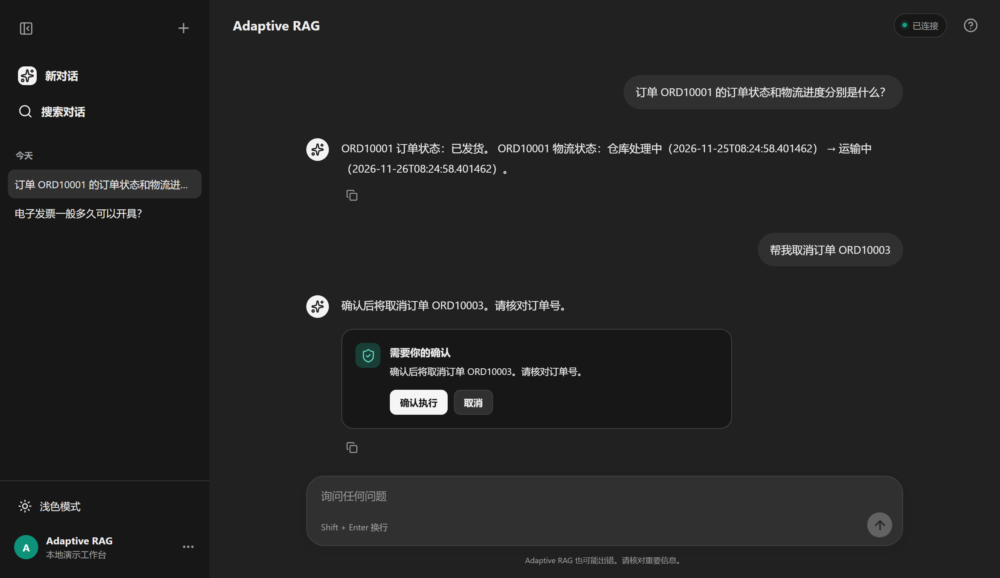
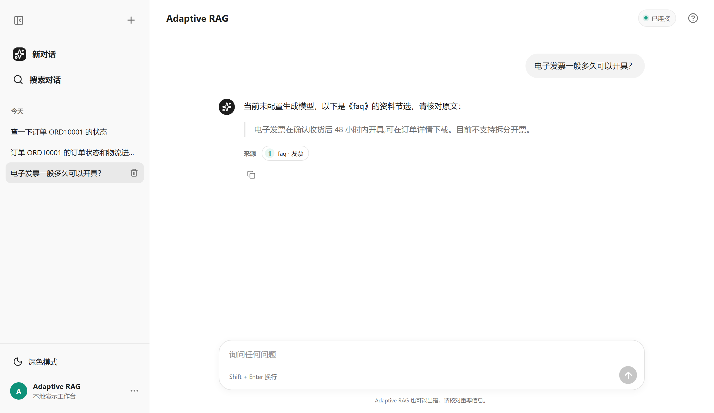
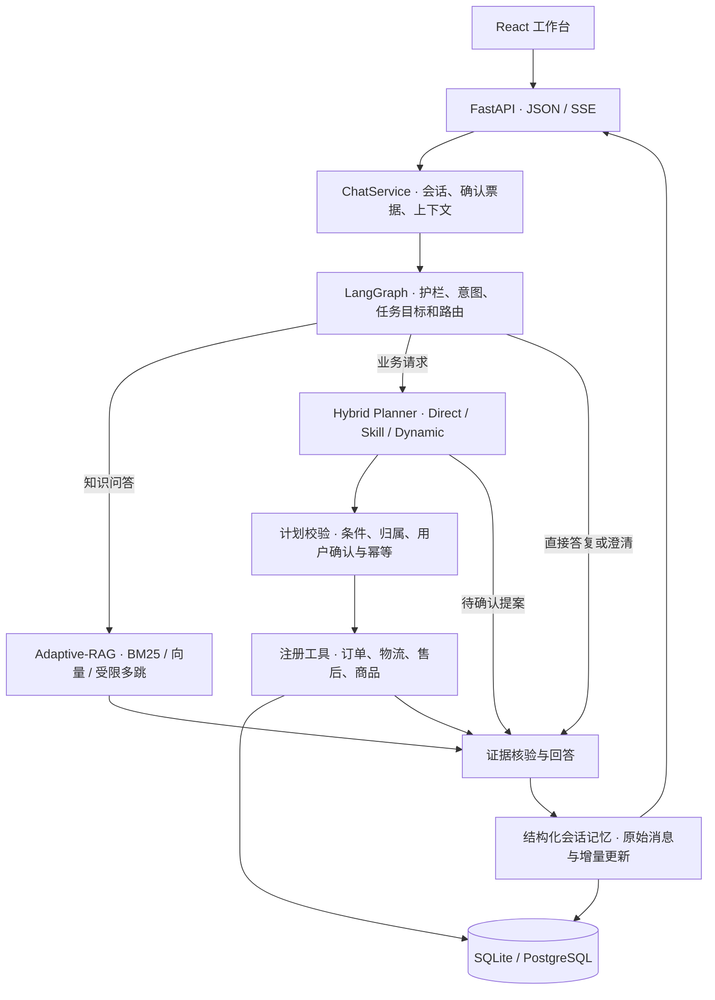

# Adaptive-RAG Agent

面向电商客服的对话工作台。它能从政策文档检索并引用来源，查询订单、物流、退款和商品，在同一会话里理解追问，并在取消订单等写操作前请求用户确认。

**技术栈**　FastAPI · LangGraph · SQLAlchemy · PostgreSQL / SQLite · React / TypeScript

## 项目演示

使用仓库自带的合成商品、订单和政策数据。界面演示使用离线 Provider。工具的实际执行结果和调用轨迹可在评测回执中复查。





[订单查询的实际 SSE 事件和工具计数](docs/assets/demo-order-sse-trace.json)

## 系统架构



[模块与调用链](docs/architecture.md) · [API](docs/api.md) · [配置](docs/configuration.md)

## 技术亮点

- **路由与 Hybrid Planner**。LangGraph 根据意图和任务目标选择知识问答或工具规划。明确的只读业务目标可直接生成最小工具计划。动态规划默认输出 JSON，也支持 DeepSeek 原生 Function Calling。
- **Agent Skills**。发现 `SKILL.md` 时只读元数据，激活后加载指令和所需参考资料。取消和退货流程可生成待确认提案。条件查询由真实上游字段决定后续步骤。
- **Adaptive-RAG**。BM25 与可选向量检索通过 RRF 合并，支持精排。复杂问答按证据充分性进行有限的查询改写和多跳检索，回答附政策来源。
- **结构化会话记忆**。保存原始消息，按任务记录实体来源、限制条件和证据引用，为不同节点筛选上下文。业务状态由当轮工具实时读取。
- **执行约束**。统一验证计划、工具参数和可用证据。订单读取校验归属，写入需要确认票据，重复操作由幂等机制保护。

## 实验结果

同一批 **15 组配对**使用真实 DeepSeek、冻结请求和合成业务数据。表中是已验收源码的历史实测，本发布版通过源码归档回归验证。严格通过同时检查实际业务结果、应执行的工具及回答中的必要事实。

| 指标 | 原始 Agent | 最终 Agent |
| --- | ---: | ---: |
| 严格任务通过 | 6/15 | 12/15 |
| 实际工具选择准确率 | 55.3% | 84.2% |
| 实际工具参数准确率 | 29.2% | 75.0% |
| 实际证据字段覆盖 | 8/26 | 20/26 |
| 模型请求次数 | 68 | 40 |

共冻结 123 条，真实请求覆盖 15 个主批配对用例和 4 个独立专项用例。其余 104 条未做付费模型验证。专项结果单列，样本不足以外推线上成功率。 [评分规则、数据与复算](eval/README.md)

| 独立测量 | 实测结果 | 口径 |
| --- | --- | --- |
| Skill 按需加载 | Intent 输入 Token 减少 **42.2%** | 3 个配对请求，提供技能目录描述与预载完整正文对比 |
| 会话上下文工程 | 全链路输入与输出 Token 减少 **7.0%** | 同一组 7 例，20,713 → 19,259，优化版独立复测 |
| RAG 检索 | **P@1 89.2%，Recall@3 94.6%** | 65 个标注问题，Recall 对每题相关文档计算后取均值 |

## 快速启动

准备 Python 3.11 和 Node.js 22.12+。首次创建环境时运行 `conda create -n adaptive-rag python=3.11 -y`，已有环境可直接激活。

```bash
git clone --depth 1 --single-branch --branch release/ecommerce-support-agent https://github.com/leizz334/Adaptive-RAG-Agent.git
cd Adaptive-RAG-Agent
conda activate adaptive-rag
python -m pip install -e ".[dev]"
cp -n .env.example .env
python -m scripts.seed_demo
npm --prefix frontend ci
npm --prefix frontend run build
python -m uvicorn app.asgi:app --host 127.0.0.1 --port 8002
```

Windows PowerShell 使用 `if (!(Test-Path .env)) { Copy-Item .env.example .env }` 创建配置，使用 `npm.cmd` 执行 npm 命令。

打开 [工作台](http://127.0.0.1:8002/) 或 [OpenAPI](http://127.0.0.1:8002/docs)。默认使用 SQLite、仓库政策文档及离线 Provider，无需 API 密钥和模型权重。示例会话使用身份 `u_demo`。配置 `DEEPSEEK_API_KEY` 后会使用真实模型并产生费用。

| 场景 | 在工作台输入 |
| --- | --- |
| 查订单和多轮追问 | 先发「查一下订单 ORD10001 的状态」，再在同一会话发「运单号是多少？」 |
| 政策及来源 | 开新会话问「定制商品支持七天无理由退货吗？」 |
| 用户确认 | 开新会话发「取消订单 ORD10003」，检查确认卡片后再确认或拒绝 |

前端开发时保持后端运行，在另一个终端执行 `npm --prefix frontend run dev`，打开 [Vite 工作台](http://127.0.0.1:5173/)。[Docker 与外部服务配置](docs/configuration.md)

## 项目结构

```text
app/
  api/          FastAPI 路由、JSON 与 SSE
  agents/       LangGraph、目标解析、规划与执行
  skills/       技能包、发现、准入与条件工作流
  memory/       会话任务记忆、实体选择与上下文预算
  retrieval/    文档入库、混合检索、精排与多跳检索
  tools/        业务工具、权限检查和目标契约
  services/     对话流程和服务装配
  repositories/ 数据模型、会话及订单持久化
  schemas/      API、计划、检索和业务数据契约
  prompts/     模型提示词
  providers/   模型、向量和精排后端
  config/      环境配置
  core/        公共类型和组件
frontend/      React 工作台
alembic/       数据库迁移
knowledge/     合成政策文档
eval/          冻结数据、评分器、脱敏回执和复现入口
tests/         回归、集成与安全用例
```

## 测试与评测

```bash
python -m pytest -q
npm --prefix frontend test
npm --prefix frontend run build
python -m eval.reproduce agent --verify
python -m eval.reproduce skills --verify
python -m eval.reproduce memory --verify
python -m eval.reproduce rag --verify
```

历史回执可在本地复算，无需 API 密钥。[真实模型评测命令](eval/README.md) · [PostgreSQL 集成测试](docs/configuration.md#postgresql-验证)

## 已知限制

- 模拟业务数据和政策用于演示，离线 Provider 用于验证链路。少量真实模型配对仍有物流、退款和条件查询漏查。
- API 从请求接收 `user_id`。公开部署需要由可信认证层绑定身份。待确认票据保存在单进程内，跨副本需共享机制。
- PostgreSQL 行锁、事务和 SSE 使用实际回环服务验证。可选 Redis / Qdrant 与多副本部署的验证范围见配置文档。
- 受限 ReAct 默认关闭。4 个真实开启专项用例均未触发重规划，因此没有建立收益证据。

[MIT License](LICENSE)
