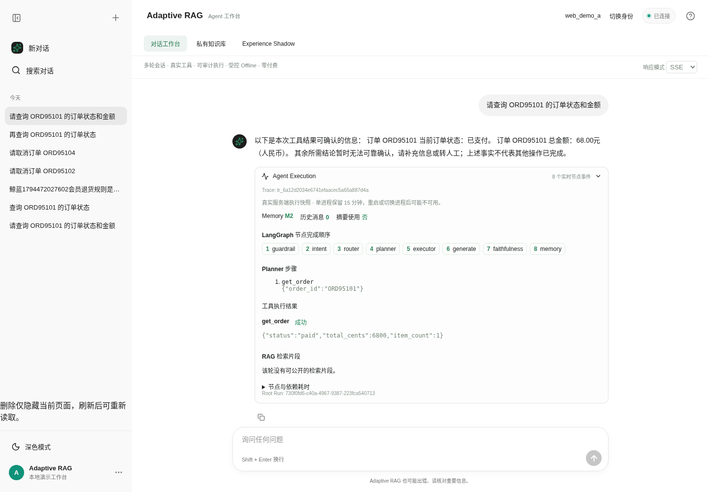
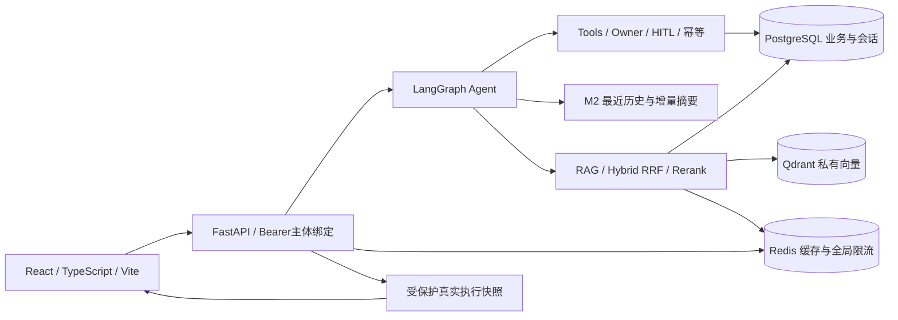
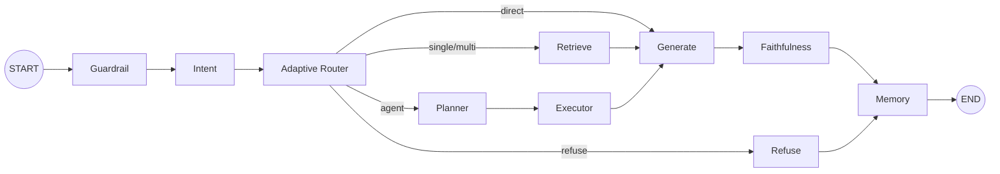

# Adaptive-RAG · Agent 业务工作台

一个围绕**知识问答、订单工具和人工确认**构建的可运行Agent工程项目。用React工作台查看多轮对话、真实来源、LangGraph执行轨迹和业务操作，展示从请求到业务终态的证据链。

**默认是受控LLM演示，零付费请求。** 真实DeepSeek评测另有冻结证据；完整语义质量尚未认证，Experience收益未建立。项目用于工程学习与面试展示，不直接宣称生产就绪。

[快速启动](#ubuntu快速启动) · [Docker验收](research/docs/agent_engineering_upgrade/s1_full_docker/S1_DOCKER_FINAL_REPORT.md) · [8分钟演示稿](research/docs/agent_engineering_upgrade/s1_showcase_release/DEMO_SCRIPT.md) · [最终验收](research/docs/agent_engineering_upgrade/s1_showcase_release/S1_RELEASE_FINAL_REPORT.md) · [工程难点](research/docs/agent_engineering_upgrade/s1_showcase_release/ENGINEERING_HIGHLIGHTS.md)

## 可以实际演示什么

| 场景 | 可见能力 | 验证方式 |
|---|---|---|
| 多轮订单查询 | 上下文指代、M2历史/摘要使用、实时订单工具、HTTP/SSE、真实节点/计划/结果 | 服务端session、实际工具调用与SQL事实 |
| 私有知识库问答 | txt/md入库/更新/删除、BM25/Dense/Hybrid检索、引用与原文、跨主体隔离 | 浏览器CRUD/问答及越权反例 |
| 取消订单 | Planner提案、HITL确认/撤销、真实业务执行、同Action幂等重放 | 订单终态和取消审计仅1次 |
| Experience历史 | 原则来源/失败类型、条件、审核/兼容状态、E0/E1/E2对照 | 只读合成历史，NOT_ESTABLISHED，无Active开关 |



上图来自实际浏览器与真实依赖，模型为受控OfflineLLMProvider。截图只作界面说明，验收使用真实浏览器E2E和数据库检查。

## 系统架构





图为主流程；guardrail拒绝和上下文澄清分支见[完整实际工作流](research/docs/agent_engineering_upgrade/s1_showcase_release/ARCHITECTURE_OVERVIEW.md)。Plan不等于执行，Memory不覆盖实时工具事实，回答不代替业务终态。

## 技术栈与代码入口

| 模块 | 技术/职责 | 入口 |
|---|---|---|
| Web工作台 | React19、TypeScript、Vite、Markdown、Vitest/Playwright | [frontend](frontend/) |
| API/身份 | FastAPI、Pydantic、Bearer哈希注册表与服务端subject绑定 | [app/api](app/api/) / [auth](app/core/auth.py) |
| Agent编排 | LangGraph状态机、Router/Planner/Tools/核验 | [graph.py](app/agents/graph.py) |
| 数据与业务 | SQLAlchemy、PostgreSQL、HITL行锁、幂等/审计 | [repositories](app/repositories/) / [tools](app/tools/) |
| RAG | BM25、Dense、Hybrid+RRF、Reranker；私有ACL全链路 | [retrieval](app/retrieval/) |
| Memory/Experience | M2上下文；原P3审核/Shadow；当前只读历史面板 | [memory](app/memory/) / [experience](app/experience/) |
| 可观测性 | 实际节点span、有限工具/检索/Memory元数据 | [observability](app/observability/) |
| 启动交付 | 每run隔离资源、健康/认证核验、停止保留卷 | [showcase.py](scripts/showcase.py) |

受控演示使用Hash Embedding与lexical重排，**不冒充真实神经检索质量**。真实Embedding/Reranker验证见P4-D。

## Ubuntu快速启动

全Docker路径（宿主只需Docker Engine和Compose，无需Python/Node）：在包含`compose.showcase.yml`的仓库版本中运行：

```bash
docker compose -f compose.showcase.yml up -d --build
docker compose -f compose.showcase.yml ps -a
```

API健康后访问`http://127.0.0.1:8000`。开发Token在独立私有卷中随机生成，不打印到启动日志；需本机操作者显式读取。Docker凭证有效期30天，停止保留卷、恢复不重置数据或静默轮换凭证。详见[Docker启动、取凭证与恢复](research/docs/agent_engineering_upgrade/s1_full_docker/DOCKER_DEPLOYMENT_GUIDE.md)。**Ubuntu已通过真实容器、7项浏览器E2E和重启持久化验收；Windows Docker Desktop：NOT_RUN。** 此路径保持OfflineLLMProvider、付费请求0、Experience Active关闭。 验收使用干净Git源码及已验证Docker缓存；冷缓存独立下载尝试因网络停滞中断，未宣称通过。

在私密本机终端显式读取A主体开发凭证（输出为秘密，勿录屏或提交）：

```bash
docker compose -f compose.showcase.yml exec -T api python -c 'from app.demo.docker import read_credentials; print(read_credentials()["tokens"]["a"])'
```

将其粘贴到页面“本地开发凭证”。Docker Snap的NNP兼容限制、内部网络边界及完整测试见[Docker最终报告](research/docs/agent_engineering_upgrade/s1_full_docker/S1_DOCKER_FINAL_REPORT.md)。

Windows + WSL Docker 使用同一个 Offline Compose；普通 WSL 用户使用 `sudo docker`，保持 WSL 会话开启。当前工作台只保留对话、会话和私有知识库。Offline 不能代替真实模型推理，政策问题需先上传当前用户的相关资料；仓库公共政策不会自动进入私有库。

需要真实 DeepSeek 时，使用独立、显式启用的 [Real Agent Dev](docs/real-agent-dev.md)：单独项目/端口/预算卷，Key 文件只在服务端挂载，必须配置有限请求、Token 和费用上限。默认 Offline 不受影响。本轮没有执行真实付费请求。

以下为已交付的宿主启动器路径：

需要Python3.11+、Node20.19+或22.12+、Docker Engine及Compose；本机验证使用Python3.12/Node22。确认当前用户可以访问本机Docker。新克隆：

```bash
git clone --branch codex/s1-showcase-release https://github.com/leizz334/Adaptive-rag.git
cd Adaptive-rag
python3 -m venv .venv
.venv/bin/python -m pip install -e '.[dev]'
npm ci --prefix frontend
npm run build --prefix frontend
.venv/bin/python -m scripts.showcase init --run-id interview_01
.venv/bin/python -m scripts.showcase serve --run-id interview_01
```

已有仓库复用当前`.venv`，不要覆盖`.env`或重复init已有run。启动器会为新run创建真实PG/Redis/Qdrant和合成业务数据，执行空库迁移，默认拒绝外部模型网络。FastAPI同源提供已构建前端。

另一终端：

```bash
.venv/bin/python -m scripts.showcase info --run-id interview_01
.venv/bin/python -m scripts.showcase status --run-id interview_01
```

`info`输出页面URL和忽略的0600私有凭证文件路径。请在本机私下读取`tokens.a`，仅粘贴到页面“本地开发凭证”框；`tokens.b`是另一个合成主体。不要把Token放VITE变量、URL、日志或提交。后端无正式登录/发证HTTP，页面不伪造生产登录。status核查真实依赖和Bearer主体，不能用health200代替完整就绪。

停止与恢复：

```bash
.venv/bin/python -m scripts.showcase stop --run-id interview_01
.venv/bin/python -m scripts.showcase start --run-id interview_01
.venv/bin/python -m scripts.showcase serve --run-id interview_01
```

开发凭证有效期为24小时；start/serve保留原凭证，不会绕过到期或覆盖文件。到期后用新run演示。stop只操作经过身份/标签核验的本run进程与容器，保留数据卷。**不执行down -v或prune。** 旧根`docker-compose.yml`是API镜像示例，不是已验完整演示路径；缺少认证/Redis等时应安全拒绝启动。[详细启动与恢复](research/docs/agent_engineering_upgrade/s1_showcase_release/STARTUP.md)。`.env.example`仅作配置参考，不替代初始化，也不要覆盖现有环境文件。

## 三个演示与浏览器验收

1. 查询“ORD95101的状态和金额”，追问“这单的商品明细和是否定制”；打开Execution查看实际工具、Memory计数、节点耗时。
2. 私有知识库上传唯一合成政策，问答查看实际citation/片段；切B主体验证不可见与拒绝，再演示完整更新/删除。
3. 请求取消未取消的ORD95102，查看Planner与HITL后确认、同Action重放；数据库仅1次写入。另用ORD95104撤销pending。

每个场景的步骤/预期/实际证据见[演示验收](research/docs/agent_engineering_upgrade/s1_showcase_release/DEMO_ACCEPTANCE.md)。已取消订单不重置，下一轮可选尚未取消的ORD95103/95105/95106/95107或新run。

```bash
cd frontend
npx playwright install chromium --only-shell
cd ..
.venv/bin/python -m scripts.showcase browser --run-id interview_01 --cancel-order ORD95102
```

这是真实Chromium、真实API/数据库测试，无route mock、单worker/重试0，会执行本run的合成取消。每轮原始报告隔离保存在私有目录，公开只输出安全汇总。

后台 Experience Memory、审核和历史实验完整保留；普通用户工作台不再提供 Experience 实验页面。[旧页面截图仅作为历史归档](research/docs/agent_engineering_upgrade/s1_showcase_release/evidence/experience_release.png)。

## 工程难点

- **完整私有ACL**：入库/Chunk、BM25/Qdrant/Hybrid、重排/引用、Redis缓存、更新/删除都绑定服务端主体，不只给向量查询加过滤。
- **写操作可靠性**：持久HITL、PostgreSQL行锁、幂等指纹/审计；以业务终态判断，不把“模型说执行”当成功。
- **故障与取消**：Redis共享原子限流，敏感操作故障fail-closed；SSE/网络超时不自动重放；身份切换中止旧请求，迟到401不清除新身份。
- **可解释与保密**：真实Trace只读、精确Owner/session/root授权；限定参数/结果字段、片段脱敏，无原始Prompt/State/summary/凭据。
- **可核验评测**：固定源码/Gold/评分器、逐请求预算账本，区分工具代理、业务状态、语义真值与组件收益；保留RED与历史未通过项。

[工程难点与代码证据](research/docs/agent_engineering_upgrade/s1_showcase_release/ENGINEERING_HIGHLIGHTS.md)。

## 测试与真实模型结果

| 证据 | 结论与范围 |
|---|---|
| S1-Web工程基线 | 934 pytest PASS +1历史SKIP；19前端测试；6真实浏览器场景；Ruff/Mypy通过 |
| 历史回归 | 214案例，202 PASS、12既有非PASS；新增严格PASS→FAIL为0 |
| 真实DeepSeek P4-C/D | 开发/独立集、真实工具/SQL/HTTP/SSE和预算记录已执行；质量结论PARTIAL，不能等同总体语义成功 |
| S1-EX真实E0/E1/E2 | 4组完整配对，60请求/54,845Token；工具/业务执行代理三臂均4/4，有界回答均2/3可评分；收益NOT_ESTABLISHED |
| S1-Release当前交付 | **951 pytest PASS +1历史SKIP、22前端测试、7真实浏览器场景**；类型/构建、Ruff/Mypy、214历史回归通过，详见[最终报告](research/docs/agent_engineering_upgrade/s1_showcase_release/S1_RELEASE_FINAL_REPORT.md) |
| S1-Docker全栈交付 | **965 pytest PASS +1历史SKIP、22前端测试、7真实浏览器场景**；Ubuntu一键Compose/重启持久化通过，Windows NOT_RUN；[证据与限制](research/docs/agent_engineering_upgrade/s1_full_docker/S1_DOCKER_FINAL_REPORT.md) |

[真实模型C](research/docs/agent_engineering_upgrade/p4_real_llm_e2e/P4-C_FINAL_REPORT.md) · [消融D](research/docs/agent_engineering_upgrade/p4_ablation_evaluation/P4-D_FINAL_REPORT.md) · [安全F](research/docs/agent_engineering_upgrade/p4_security_remediation/P4-F_FINAL_REPORT.md) · [Experience S1-EX](research/docs/agent_engineering_upgrade/s1_experience_optimization/S1-EX_FINAL_REPORT.md)

本阶段不重跑已完成付费实验，不修改历史Gold或原始分数。完整开放语义人工审核仍NOT_ASSESSED，AI结构标签不冒充人工审批。截图和受控LLM工程结果不代替真实模型质量结果。

开发检查：

```bash
npm test --prefix frontend
npm run typecheck --prefix frontend
npm run build --prefix frontend
.venv/bin/ruff check app tests eval alembic research scripts/showcase.py
.venv/bin/mypy
.venv/bin/python -m research.docs.agent_engineering_upgrade.p4_final_acceptance.offline pytest tests -q
```

真实依赖全量回归需要单独全新验证项目和既有run-id参数，见[完整验证命令](research/docs/agent_engineering_upgrade/s1_showcase_release/VERIFYING.md)；不要对演示或用户数据库执行破坏性迁移回环。

## 已知限制与后续学习

凭证仅页面内存，刷新后重新认证；可读取本人最近50个服务端会话、每会话最近100条user/assistant文本。历史不恢复旧引用/Trace/人工确认权限，超出数量明确受限；页面删除只隐藏，不删除SQL历史。无生产登录/发证或组织共享。私有文档至多100篇/主体、10000字符/篇，只支持txt/md完整更新；Trace是128条/15分钟单进程快照，重启/worker切换可能404。Memory M3偏好原型不作为已上线能力，Experience Active关闭。TLS、凭证轮换、备份擦除等完整生产条件未认证。

后续S2建议学习事务/异步取消、独立语义评测、身份与运维边界，详见[工程说明](research/docs/agent_engineering_upgrade/s1_showcase_release/ENGINEERING_HIGHLIGHTS.md)。本交付不自动启动S2/S3/P5。

项目使用[MIT License](LICENSE)。
