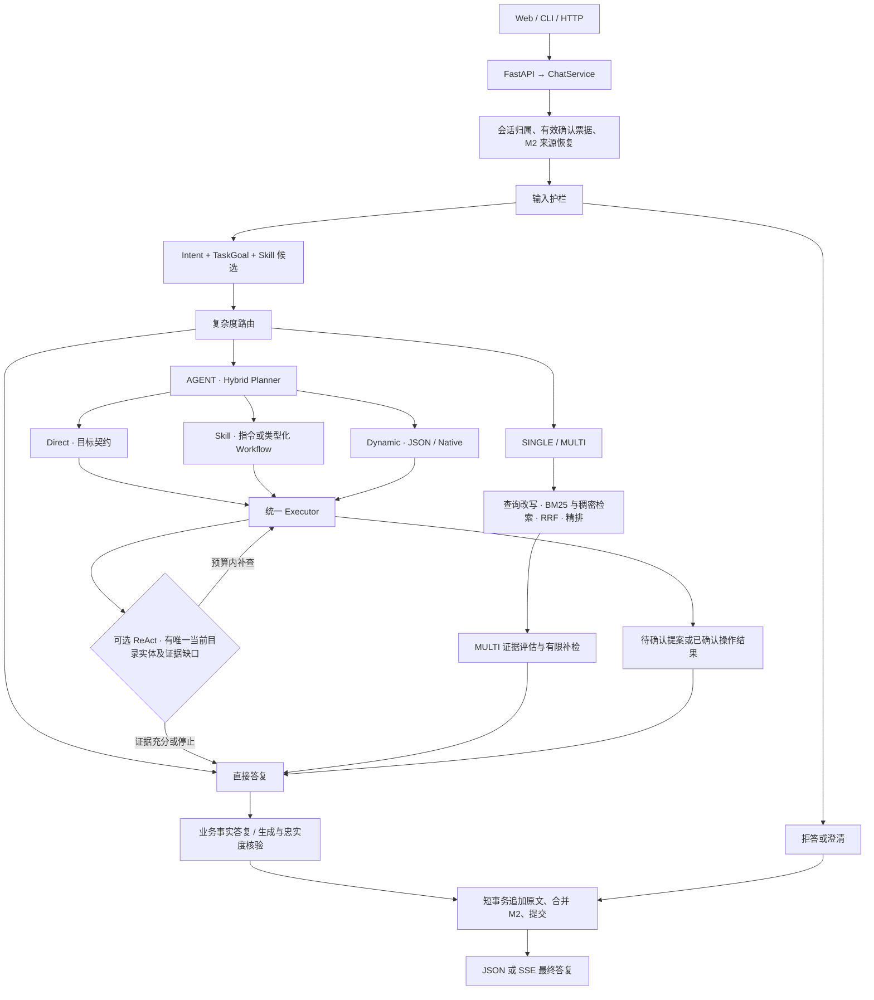

# Adaptive-RAG 最终架构

## 请求与知识检索

`app.asgi` 暴露 FastAPI 应用，lifespan 完成 Provider、检索器、工具注册表、限流和会话仓储装配。ChatService 开始读取会话和确认票据，组装 Graph 状态。护栏先处理显式注入，并允许上下文歧义进入澄清。Intent 将本轮请求解析为类型化目标，Router 决定直接答复、单跳、多跳、业务规划或拒答。RAG 路由的 `DIRECT` 是无检索的答复策略。Hybrid Planner 的 Direct 是业务工具计划，可以实际读取数据。 [HTTP 入口](../app/main.py) · [应用编排](../app/services/chat_service.py) · [Graph](../app/agents/graph.py)

知识文档经拆分后建立 BM25 及向量索引。检索阶段对结果做 RRF 融合和预算内精排。Multi 分支通过 Self-RAG 做查询改写、检索和证据评估，在已有跳数限制内决定是否补查。Answer 使用选中的证据和引用；忠实度检查可触发已有修正或证据不足降级。降级环境使用实际配置报告的本地后端。 [混合检索](../app/retrieval/hybrid.py) · [Self-RAG](../app/retrieval/self_rag.py) · [核验节点](../app/agents/nodes/faithfulness.py)

## 规划、技能和有限 ReAct

TaskGoal 描述用户目标、实体来源、字段、条件及操作类型。目标契约区分具备能力的工具、可绑定的参数和成功取得的证据。Direct 从已解析的只读目标构造并去重。Skill Registry 发现 `SKILL.md` 元数据，Selector 核验候选后才载入指令或 Workflow。顺序明确的写入技能生成待确认提案，条件式读取按真实前置结果执行。Dynamic 保留 JSON 默认，也可配置 Native Function Calling。两种结果最终进入同一计划和权限链。 [目标](../app/agents/goals.py) · [读契约](../app/tools/goal_contract.py) · [规划器](../app/agents/nodes/planner.py) · [技能选择](../app/skills/selector.py)

当 `REACT_ENABLED=true` 且 Dynamic 目录计划获准继续时，执行器先读真实目录。唯一匹配的当前结果提供 SKU。字段缺失时允许补商品详情，用户明确要求通用保修摘要时允许查对应 SKU 的摘要。每个补查通过注册参数和只读校验，与首轮共用工具调用和步骤预算，最多两轮。结果完整直接进入 Answer；另有歧义、失败、重复、无进展或预算停止。保修工具的摘要为通用数据，SKU 仅标明查询对象。选项默认关闭。 [有限重规划](../app/agents/react.py) · [统一执行器](../app/agents/nodes/executor.py) · [工作流校验](../app/agents/workflow_execution.py)

## Memory 和权限边界

原始用户与助手消息保存在会话内。M2 摘要按同会话来源保存任务、实体、少量约束、证据引用及处理进度。旧版本按原始来源重建；短事务在 PostgreSQL 会话行上加锁，追加消息后合并游标和记录。读取和生成阶段在锁外。Intent 接收相关原文与实体候选，Planner 接收选中实体及必要任务范围，Executor 使用计划和权限，Answer 使用当前工具结果。历史业务值需实时核实，审批以当前确认票据为准。 [会话仓储](../app/repositories/session_repository.py) · [任务记忆](../app/memory/task_memory.py) · [上下文视图](../app/memory/context.py)

Executor 的工具风险、订单归属、确认和幂等保护互相独立。API 当前使用请求中的 `user_id`，外部部署需要可信身份绑定。确认票据保存在 ChatService 进程内，多副本之间无共享票据保证。SSE 提前发送状态事件，文本在核验完成后分块发送。生产 Trace 记录脱敏类别和指标，真实评测的完整模型输入仅使用合成数据。 [权限](../app/tools/permissions.py) · [SSE 与确认](../app/services/chat_service.py) · [Trace](../app/observability/tracing.py)

[评测数据、证据与复现](../eval/README.md)
