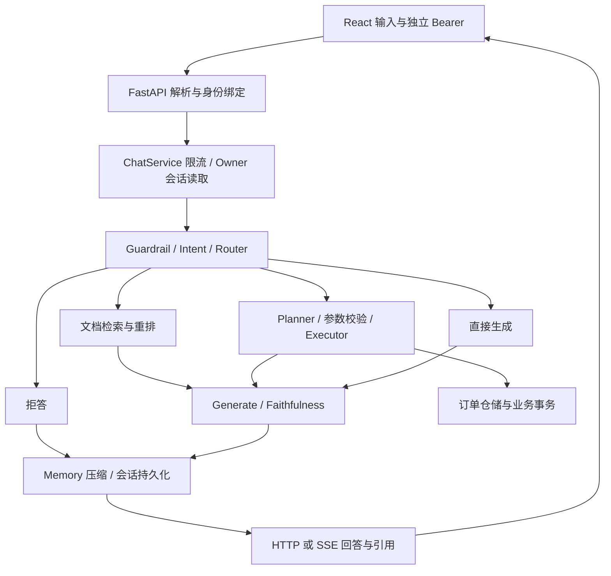

# Adaptive-RAG 项目专项面试

本分册负责原题 Q001—Q013。先讲可核验的实现，再谈设计方案；个人贡献、用户规模和上线指标不能由代码反推。★核心60 为第一批复习题。所有运行数字均注明历史口径，本轮只整理文档。

### Q001：3分钟介绍你的 Adaptive-RAG，实际解决什么业务问题？

★ 核心60

#### 1. 标准答案

按“业务失败—系统设计—正确性约束—验证边界”介绍。电商客服既要解释非结构化政策，又要查询实时订单，取消订单还会产生副作用。一次生成无法同时提供数据新鲜度、访问权限与事务正确性，因此系统把政策检索、结构化业务工具和回答生成分开，再用可控执行图组合。需要三分钟时，分别用约半分钟说明问题、一分钟说明链路、一分钟说明安全与实证，最后说明限制；不要把组件清单当作项目价值。

核心价值是“可核验地完成合法任务”：查单必须依据工具结果，政策回答必须有实际引用，写操作必须有人确认且不能重复执行。回答流畅只是体验指标，不能代替工具正确性。这个仓库是开发与验收项目；没有足够证据证明正式商业用户规模或线上 SLA。

#### 2. 面试口述版

以下是60—90秒骨架；原题要求三分钟时，再按上一节展开一个具体工具案例、证据和失败边界。

这个项目解决的是电商客服从回答问题走向查询和执行业务时的可靠性问题。比如问退货政策，需要找到有权限访问的文档；问订单金额，必须查询数据库；取消订单则必须确认身份、人工确认并避免重复执行。我用 FastAPI 作为统一入口，用 LangGraph 把意图、路由、检索、规划、工具和答案校验组织成可观察的执行图。模型负责理解和建议，业务权限与副作用由服务端控制。验证时我会把 Offline、Mock 和真实模型分开讲：历史真实验收支持订单、Memory、RAG 和不存在订单四项，HITL 的真实模型端到端仍未运行，所以不会把整个系统描述成已经规模化上线。项目重点是能追溯每个结论与动作，而不是堆框架名。

#### 3. Adaptive-RAG实际实现

**已实现，运行模式有差异。** [create_app](../../app/main.py#L43) 组装路由与鉴权；[build_container](../../app/services/container.py#L128) 注入 Provider、检索器、工具和服务；[build_graph](../../app/agents/graph.py#L45) 定义图；[ChatService.chat](../../app/services/chat_service.py#L88) 管理请求级 Session、图调用和持久化。真实模式入口 [create_application](../../app/demo/real_dev.py#L152) 复用同一业务图并包裹付费门禁。真实模型能力、检索模块存在和 Docker 当前是否加载真实 Embedding 权重是三个不同结论，不能混说。

#### 4. 面试官可能追问

- **追问：为什么不能直接让模型查库？** 答：模型只能建议已注册工具和参数；身份、只读/写权限、SQL 和事务由可信代码决定，防止越权与任意 SQL。
- **追问：这是多 Agent 系统吗？** 答：主要是有多个职责节点的受控 Agent 图，不能把多个节点直接说成独立协作的多 Agent 团队。
- **追问：项目成功率是多少？** 答：先限定集合和模式；一次真实验收四项通过、HITL 未运行，不能推出泛化成功率或线上 SLA。

#### 5. 测试与证据

[2026-11-15 真实验收表](../../research/docs/agent_engineering_upgrade/deepseek_business_acceptance/REPORT.zh-CN.md#L9) 记录四项 PASS 与 HITL NOT_RUN；20 次模型响应成功不等于五项业务全部通过。[test_health_and_chat_greeting](../../tests/e2e/test_chat_api.py#L16) 是本地测试入口示例，不能据文件名推断调用真实模型。商业用户规模与生产 SLA：**未验证**。本轮未运行上述测试或付费请求。

### Q002：从用户输入到最终回答，画出前端、FastAPI、LangGraph、工具和数据库的完整链路。

★ 核心60

#### 1. 标准答案

要把控制流、数据流和安全边界分开。请求进入后先解析身份并绑定主体，业务层限流、读取所属会话，构造本轮状态。图决定直接生成、检索或规划工具；检索面对文档证据，工具面对结构化事实。生成后再检查证据支持情况，持久化结果和摘要。HTTP 返回完整响应；SSE 则传递进度与经过校验的答案，不能把尚未校验的推测当作已完成动作。

图省略了基础设施内部细节；拒答直接进入 Memory，不能据此声称每条请求都调用所有节点。

#### 2. 面试口述版

我会先画三层：前端与身份入口、Agent 执行层、数据与工具层。前端携带当前环境的 Bearer，FastAPI 校验后把主体绑定到请求，而不是相信浏览器提交的用户编号。ChatService 负责限流、加载有归属的会话并组装图状态。图经过护栏、意图和路由后，简单问题可以直接答，政策问题走检索，订单问题由 Planner 生成受限制的计划，再由 Executor 校验并调用工具。工具通过仓储访问数据库，模型不直接执行 SQL。之后答案检查引用和事实支持，保存消息与摘要，再经 HTTP 或 SSE 返回。遇到写操作会先返回确认提案。SSE 是传输方式，不代表工具成功或事务已提交，这两者必须看服务端执行和数据库证据。

#### 3. Adaptive-RAG实际实现

**已实现。** [authenticated_payload](../../app/api/dependencies.py#L20) 调用身份绑定；[ChatService.chat / stream](../../app/services/chat_service.py#L88) 组织请求与 SQL 持久化；[build_graph](../../app/agents/graph.py#L45) 的条件边对应检索、计划、直接回答和拒答。工具由 [ToolRegistry](../../app/tools/registry.py#L9) 注册，执行入口是 [executor_node](../../app/agents/nodes/executor.py#L120)。[ChatService._load_confirmation](../../app/services/chat_service.py#L272) 从数据库加载有归属的提案并加锁。这里的数据库会话持久化**不是 LangGraph Checkpointer**。

#### 4. 面试官可能追问

- **追问：哪个地方决定请求属于谁？** 答：可信 Bearer 对应主体，经服务端 `bind_identity` 绑定；会话和工具还需再次按 Owner 查数据。
- **追问：一条用户请求等于一次模型请求吗？** 答：不等，意图、复杂度、规划、生成和评判可能分别调用模型，账本按实际供应商尝试计数。
- **追问：SSE 已发进度后数据库失败怎么办？** 答：状态码通常不能再改，要发送结构化 error/done，前端不能把已有进度当作最终提交证明。

#### 5. 测试与证据

[test_chat_stream_emits_token_and_node_events](../../tests/e2e/test_chat_api.py#L50) 检查本地 SSE 事件；[test_service_graph_sse_privacy_and_disabled_parity](../../tests/integration/test_agent_tracing.py#L14) 检查图、SSE 与隐私口径；[真实 Chromium 与订单链路](../../research/docs/agent_engineering_upgrade/deepseek_business_acceptance/REPORT.zh-CN.md#L19) 属于历史真实调用证据。错误恢复不是“图节点可任意断点续跑”，该能力**项目未实现**。本轮仅源码核验。

### Q003：为什么这个问题需要 Agent，不直接调用一次 LLM？

★ 核心60

#### 1. 标准答案

先判断问题是否需要动态观察和行动。纯文案改写一次 LLM 往往够用；事实取自企业文档时需要检索；事实取自当前订单状态时需要业务工具；任务还会产生副作用时，必须加入身份、确认与幂等控制。Agent 的必要性来自“根据观察选择下一步”，不是因为聊天入口天然需要复杂编排。

单次模型调用可以输出 JSON，但不能凭输出保证数据确实存在、权限合法或订单已取消。受控 Agent 把理解与规划交给模型，把事实获取、验证、提交和终止交给代码。代价是多次请求带来的延迟、成本和故障组合，所以必须限制计划、工具集合与预算；不值得用 Agent 的请求应走短路路径。

#### 2. 面试口述版

我不会说所有客服问题都必须上 Agent。像问候或固定说明，一次调用甚至规则就够了；但查订单必须读取实时状态，问售后政策需要找正确且有权限的文档，取消订单还要得到确认并完成事务。模型一次回答只能表达它的判断，不能证明这些操作实际发生。项目因此把模型用在理解、路由和有限规划，把业务动作放在明确的工具与服务端约束后面。这样能够根据问题选择不同路径，又能检查工具观察和最终回答是否一致。代价是一次用户问题可能触发多次模型请求，所以我还会记录节点耗时和实际请求次数，使用保守费用预留，并给简单问题保留短路径，避免为了展示 Agent 把所有请求都变复杂。

#### 3. Adaptive-RAG实际实现

**已实现有限 Agent，未实现开放式无限自治。** [_route_after_complexity](../../app/agents/graph.py#L33) 支持直接生成、拒答、单/多路检索和工具计划；[planner_node](../../app/agents/nodes/planner.py#L339) 构造受约束计划；[executor_node](../../app/agents/nodes/executor.py#L120) 执行可信工具。实际数据通过仓储获取，不能把模型自然语言中的“已取消”视为提交结果。[BudgetedTransport.handle_async_request](../../app/providers/paid_budget.py#L809) 对每次供应商 HTTP 进行发送前门禁。它不是一套替代所有 Workflow 的通用自主代理。

#### 4. 面试官可能追问

- **追问：工具选择本身也可写规则，为什么用模型？** 答：自然语言意图和组合需求变化较多时模型更灵活；固定高风险动作仍用规则与 Schema 收束，不让模型定义权限。
- **追问：多次调用的效果一定比一次好吗？** 答：不一定；应比较任务成功率、成本和延迟的净收益，反思或检索增加却不改善结果就应简化。
- **追问：Agent 能替代事务吗？** 答：不能，事务和幂等是执行正确性，不能由语言推理或重试提示词替代。

#### 5. 测试与证据

[test_order_is_scoped_to_owner](../../tests/integration/test_orders.py#L50) 体现事实访问的执行边界；[真实验收表](../../research/docs/agent_engineering_upgrade/deepseek_business_acceptance/REPORT.zh-CN.md#L9) 展示订单、Memory、RAG 和异常场景，不证明所有任务都需要 Agent。与“单次 LLM”在同集合、同价格/延迟条件下的在线总体增益：**未验证**，不能拿这次20次成功响应作为对照实验。

### Q006：最难的真实 Bug 是什么？如何保存证据、定位根因并验证修复？

★ 核心60

#### 1. 标准答案

好的案例应包含现象、证据、可证伪假设、最小复现、最小修复和修复边界。项目中可核验的案例是“业务回答成功，但费用账本没有按可信 usage 结算”。不能因为调用方拿到 JSON 就认定底层观察器看见了同样的数据：HTTP 传输层可能是压缩字节，应用层已自动解压，两个消费者处于不同协议层。

定位时先暂停付费，保存失败记录和原预留，不靠重新消费覆盖证据；用本地 gzip/deflate JSON/SSE 响应复现差异；修复双方观察同一份解压实体，同时处理编码与长度头，防止二次解压。再覆盖读取、关闭、取消、解码错误，确认异常仍保守处理。真实后续验证不能倒推未留存的历史头部，更不能事后给旧请求返额。

#### 2. 面试口述版

项目里有个很适合解释排障方法的真实案例：订单已经查对，页面也拿到了答案，但账本仍保留最大预留，usage 没有结算。我们先关掉付费入口并保存五次失败结算记录，而不是继续重跑。随后用本地压缩响应复现发现，预算观察层读取的是传输层压缩字节，HTTPX 给 Provider 的却是解压后的内容，导致业务成功而账本解析失败。修复让两者共用解压后的实体，避免重复解压，并补齐关闭失败、取消和截断测试。后续真实调用能正常结算，但最初五条仍保守占用，因为没有留存当时的编码头，不能声称每条原因都已追溯证明。讲这个案例时，个人亲自完成的部分还应按真实参与情况说明，不把仓库修复记录直接等同于个人独立贡献。

#### 3. Adaptive-RAG实际实现

**已实现修复。** [_DecodedEntityStream](../../app/providers/paid_budget.py#L690) 使用 HTTPX 公开解码流；[_BudgetStream._close](../../app/providers/paid_budget.py#L749) 在完整读取且关闭成功后才结算；[BudgetedTransport.handle_async_request](../../app/providers/paid_budget.py#L809) 交付解压实体并避免下游重复解压。[AttemptLedger.settle](../../app/providers/paid_budget.py#L551) 追加可信用量，原请求与预留不改写。未保存完整响应正文是隐私取舍，也限制历史根因复原能力。

#### 4. 面试官可能追问

- **追问：为什么不直接把旧预留按 Trace 返还？** 答：旧记录缺少当时完整的结算证据，重建或猜测会削弱预算审计；保留原占用更保守。
- **追问：怎么证明不是模型输出偶然变化？** 答：先以固定本地压缩响应形成 RED→GREEN，再看真实后续；本地机制证明与历史每条真实原因是不同结论。
- **追问：只改 JSON 解码足够吗？** 答：不够，还要防二次解压，保持 SSE、取消、关闭失败和不确定消费的原有安全语义。

#### 5. 测试与证据

[test_compressed_provider_success_settles_decoded_usage](../../tests/unit/test_paid_budget_compression.py#L26) 是本地 gzip/deflate、JSON/SSE 回归；[关闭边界用例](../../tests/unit/test_paid_budget_compression.py#L65) 检查取消和失败。它们属于 MockTransport/合成响应，不是付费测试。[历史修复与保守收费说明](../../research/docs/agent_engineering_upgrade/deepseek_business_acceptance/REPORT.zh-CN.md#L52) 记录真实后15次结算及前5次保持预留。历史947项通过不是本轮重跑；个人贡献与每条旧响应编码：**未验证**。
