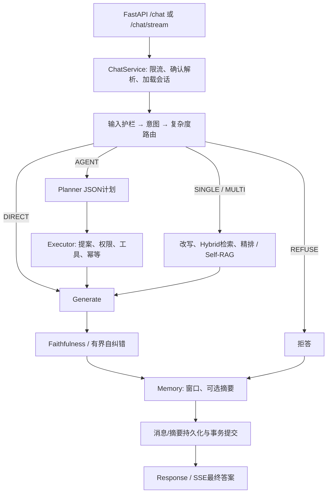

# Adaptive-RAG — P0 Unified Audit Report

本次只读审计的核心结论：**现有系统已有可复用的 RAG、受限工具规划、HITL、会话存储及基础可观测性；尚不具备可靠的多轮 Agent 评测、完整调用级 Trace 或经过验证的经验学习闭环。首先需要可信身份与数据隔离、可靠失败信号，再评估记忆和经验是否带来收益。**

源码基线为 `2a12a62382a8c3ec033fa9a5b19b9b23b8780ab8`。P0-A 保留2026-10-31的原始交付；后续连续授权审计完成于2026-11-01，未改变该业务源码基线。仅根 `AGENTS.md` 的 Coding Agent 连续执行协议，以及本审计目录中的文件发生授权变更。没有启动应用、调用业务工具、运行模型、接入追踪服务或开始后续工程。

## 1. 报告导航、证据与恢复

<!-- acceptance: P0-G.1 -->

| 任务 | 交付报告 | 已核实的交付 commit |
|---|---|---|
| P0-A / 架构 | [architecture.md](audits/architecture.md) | `6fbd7deefbaed209b4b7e73c9d63a7d8f693340a` |
| P0-B / Memory与Context | [memory_context.md](audits/memory_context.md) | `aa98c115e6ee634715b0feff932d66caff99ace4` |
| P0-C / 评测 | [evaluation.md](audits/evaluation.md) | `87981e43972b5db5d3f6349c7656baa45e722ef3` |
| P0-D / Tracing | [tracing.md](audits/tracing.md) | `1b301f65e538c9bcb661d7e364d12242f4f7be92` |
| P0-E / 失败经验 | [experience_memory.md](audits/experience_memory.md) | `ef220ef52e3304195661b401ff0755ee550795f6` |
| P0-F / 安全与工程 | [security.md](audits/security.md) | `15ae2b963fd8cc1d34e1d8c4405592e5ab137d85` |
| P0-G / 综合 | 本报告 | 验收后写入状态文件，避免自引用提交哈希 |

每个交付 commit 后另有元数据 checkpoint，记录真实交付 hash。原 Initializer 仅执行一次；后续没有重新初始化 Git 或任务。连续执行协议授权 commit：`7adae4b0b402f1ebe9181f1a77d68b17fc53d8de`。

恢复来源：[feature-list.json](feature-list.json)、[progress.txt](progress.txt)、`git log` 和实际交付文件。早期状态中因 shell 编码损坏而变成问号的描述/验收文字已按用户原始范围恢复为英文，原文件保存在 [状态备份](evidence/feature-list.before-continuation.json)，任务ID、依赖、已完成状态和原提交哈希未重建。AGENTS 原始哈希与授权变更哈希见 [continuation-authorization.json](evidence/continuation-authorization.json)。这不等于重复 Initializer。

证据约定：SOURCE_VERIFIED = 当前源码、数据或已阅读测试断言；TEST_VERIFIED = 实际执行的隔离探针，必须注明范围；DOCUMENTED_ONLY = 历史报告、论文或平台文档；HYPOTHESIS = 设计建议或未验证影响；BLOCKED = 因安全/授权范围没有运行的验证。**测试文件存在不表示测试运行通过，审计 passes 不表示业务缺陷已经修复。**

## 2. 当前架构和真实执行链

SOURCE_VERIFIED：入口为 [app/asgi.py:5](../../../app/asgi.py#L5) 的 `app = create_app()`；[lifespan](../../../app/main.py#L30) 构建共享组件；[ChatService.chat](../../../app/services/chat_service.py#L70) 管理每轮状态与事务；[build_graph](../../../app/agents/graph.py#L45) 决定节点执行。



图为理解用简图；提案并不是实际执行写工具，拒答和异常/SSE还有分支，完整边见 [架构审计](audits/architecture.md)。主要技术及边界如下。

| 技术 | 当前用途和适用原因 | 不能从其存在推导的能力 |
|---|---|---|
| FastAPI / Pydantic | 请求/响应校验、异步API和错误映射 | Schema校验不等于认证或业务正确 |
| LangGraph / AgentState | 明确策略分支、节点间部分状态传递 | 图无执行反馈回边；compile未接checkpointer；会话记录不是图恢复 |
| DeepSeekProvider + httpx | [generate:48](../../../app/providers/deepseek.py#L48) 自定义异步HTTP、JSON输出、重试 | 当前不是模型原生tool_calls；普通httpx调用不会自动获得完整LLM语义Span |
| BM25 + Dense + RRF + Cross-Encoder | [Hybrid.retrieve](../../../app/retrieval/hybrid.py#L37)、[检索节点](../../../app/agents/nodes/retrieval.py#L18)；结合词项和语义召回，再精排 | 在线实际后端可能fallback；需要评测，不能声称组合必然最优 |
| Self-RAG / Faithfulness | 有界补检、证据充分性及本轮答案校验/纠错 | 不是跨任务经验库；Checker失败不等于已证实幻觉 |
| SQLAlchemy / SQL数据库 | 会话、订单、申请、审计、幂等；请求作用域事务 | 生产PostgreSQL支持不表示本机连接已验证；默认SQLite；事务不能回滚远程工具副作用 |
| Redis / Qdrant（可选） | 公共政策短缓存/限流，向量存储；也有内存降级 | 未具备可直接用于私有Memory/Experience的ACL、状态/版本过滤 |

Prompt 的实际模型输入由各节点构造，而不是模板文件自动注入：[Planner.create_plan](../../../app/agents/nodes/planner.py#L37)、[generate_node](../../../app/agents/nodes/generate.py#L68)、[FaithfulnessChecker.check](../../../app/guardrails/hallucination.py#L24)。Planner用文字工具目录输出JSON，Executor调用Tool.run/Pydantic参数校验/Handler。没有通用上一步结果自动绑定后一步参数或执行后重新规划循环。

当前 SSE 是 Graph updates 进度，最终答案验证后每48字符切段发送；不是Provider真实增量输出：[ChatService.stream](../../../app/services/chat_service.py#L84)。观察首段不能当模型首Token时延。启动容器可能 create_all、加载模型、入向量库，因此本次没有以“试运行服务”验证架构。

## 3. 已实现能力与实际缺口

| 领域 | 已实现（SOURCE_VERIFIED） | 缺口及证据 |
|---|---|---|
| 会话 | 最近20条消息读取、消息/摘要字段与持久化 | [_initial_state](../../../app/services/chat_service.py#L161) 每轮summary为空；Generate不消费历史；Intent/Router只看本轮 |
| Context | 字符近似预算、输出压缩、滑动窗口、可选摘要 | [memory_node](../../../app/agents/nodes/memory.py#L11) 在生成后；预算漏证据/工具/system等；先截断再摘要 |
| 工具与HITL | 白名单、Schema、显式写提案、确认记录绑定user/session、顺序幂等 | 身份不可信、审批仅进程内；业务资格和并发语义不足；EXTERNAL没有同等写门禁 |
| 评测 | 意图100条、RAG65条、Agent E2E16条；检索算术和回答支持性评分 | [tool_path_hit](../../../eval/runner.py#L442) 是答案关键词启发式；无参数/轨迹/终态oracle、多轮任务成功评测 |
| 可观测性 | trace_id、结构化日志、Prometheus、节点进度与局部耗时 | [完成观测](../../../app/services/chat_service.py#L271) 不覆盖全部异常；缺少统一父子Span、所有LLM用途/attempt用量 |
| 失败反思 | [本轮自纠错](../../../app/agents/nodes/faithfulness.py#L18) | 未发现经验实体、审核/版本/召回、可靠任务级失败分类 |
| 安全 | 明显注入正则、不可信内容告示、订单owner比较、部分脱敏 | 聊天无认证主体，Session无归属核验；间接注入未系统评测，脱敏有复现遗漏 |

## 4. Memory 与 Context 的优先方向

根据 [B报告](audits/memory_context.md)，建议先闭合“授权读取 → 节点前构造 → 完整预算 → 模型实际输入 → 持久化/下轮恢复”的链。不要用增加数据库字段代替检查模型到底收到了什么。

建议分层：Working Memory 是本轮State；Conversation Memory 是授权会话事件；Summary是带覆盖水位/版本/来源的派生物；Long-term User Memory 仅保存用户同意的稳定偏好。Context Builder针对Intent/Router/Planner/Generate选择必要信息；Memory Retrieval与业务知识检索分开；Compaction应在丢弃前提取并核验关键信息。

业务订单、库存、退款当前状态只能以权威业务读取为准；历史说法和用户偏好不覆盖权限或当前状态。先解决可信user/tenant和Session owner，再考虑跨会话记忆。借鉴OpenClaw的分层与压缩思想，不移植共享Markdown存储；官方来源已列于B。

| 对照 | 建议策略（HYPOTHESIS，全部未运行） | 主要判断 |
|---|---|---|
| M0 | 无历史 | 当前有效生成输入的基线 |
| M1 | 最近消息窗口 | 指代/槽位连续性 |
| M2 | 窗口+带水位摘要 | 超窗口关键约束保留 |
| M3 | M2+选择性长期偏好 | 跨会话收益与隐私/新鲜度成本 |

固定模型、业务快照、权限与调用预算，按完整对话/场景族配对；报告任务终态成功、指代正确、旧事实误用、跨用户/删除后泄漏、Tokens及P50/P95。Memory和Experience实验分开，不能同时修改两轴再把收益全部归因其中之一。

## 5. Evaluation V2 最小可行方案

根据 [C报告](audits/evaluation.md)，保留自写runner/pytest，优先修复评分定义和隔离环境，不先迁移整套框架。

- **确定性代码为主**：结构化记录实际工具选择、规范化参数、合法轨迹/依赖、审批和提交；独立读取隔离DB终态及不应变化对象，满足目标且没有禁止副作用才算成功。pending、正确安全拒绝、业务拒绝、技术失败分开。
- **LLM-as-a-Judge为辅**：评价语义/支持性/完整性，固定rubric和模型版本，使用 supported/unsupported/judge_error 三态；独立模型减少共同偏差的可能性需校准，不能当保证。
- **人工校准**：盲审边界例、硬负例与模型分歧，复核混淆矩阵和裁判一致性；反思器不能自批自己的经验。

现有源码评分问题已复现：错订单号仍能tool_path_hit；不应拒答而拒答不进入拒答错误分母；Checker不可用返回supported=false并混入幻觉口径。相同DeepSeek对象兼任生成和裁判；真实偏差大小未测。现有 [订单owner测试](../../../tests/integration/test_orders.py#L50)、[确认测试](../../../tests/unit/test_action_confirmation.py#L25) 有局部断言，不能替代完整Agent任务评分。

V2结果关联case/family/task/turn、root_run/app_trace_id、模型/Prompt/知识/工具/Memory/Experience版本与实际backend；线上语义复用ChatService/Graph，另设少量HTTP/SSE协议验证。评测强制隔离数据库/namespace和外部工具，避免当前 [seed=True E2E](../../../eval/runner.py#L408) 使用配置业务库、写会话或产生费用。

自写V2迁移成本最低；DeepEval适合工具/语义评估适配，Ragas适合检索与响应/Agent语义补充；两者都不能替代本项目数据库终态和审批oracle。平台评测可以承载结果/人工队列，但不应改变本地硬约束真值。官方资料和成本取舍见C，未安装或试用框架。

## 6. Trace 接入建议

根据 [D报告](audits/tracing.md)，先定义平台无关的事件、错误、隐私和ID契约，再选一套后端。LangSmith是最小侵入候选，原因是已有LangGraph栈和传递安装的SDK；自定义DeepSeek、Retriever、Tool和Memory仍需手动语义边界，不应换供应商SDK来追踪。

若批准云端导出，可优先验证LangSmith；若要求数据留本地，比较Phoenix/OpenInference/OTel或Langfuse自托管成本。OpenTelemetry提供传播和标准Span，不自动提供Agent终态评测。当前Conda LangSmith0.14.12与lock0.14.7不同；最新官方文档不证明旧图栈兼容。尚未调用SDK或服务。

建议每轮服务端UUID root，现有 `tr_...` 作为经校验的app_trace_id元数据；task_run_id关联跨轮确认，session/user只用受控伪名。父子树覆盖 `turn → session/confirmation → graph/node → llm/retrieval/tool → attempt`，图后仍记录persist/commit和SSE delivery。每个LLM用途、实际网络尝试、可得tokens/unknown usage分别统计；Prometheus保留聚合，不添加请求级高基数labels。

Async generator根范围覆盖真正迭代/关闭，验证create_task、to_thread父关系、取消后清理；SSE已提交但未送达与执行失败分开。后台导出应有队列/超时上限，遥测故障不得重试业务写入。默认不导出原始State、Prompt、工具结果、异常或PII；白名单、嵌套脱敏、长度限制、保留与删除必须先通过合成探针。自托管也需要这些边界。

## 7. Failure Reflection / Experience Memory 可行性

根据 [E报告](audits/experience_memory.md)，**文本经验方案有条件可行，但必须依赖可信失败标签、完整脱敏轨迹、主体隔离和独立验证；当前尚未实现或证明收益。** Self-Direction论文实际包含LoRA适配器训练，本项目仅借鉴失败纠正和相关复用的思想，不复现其训练，也不借用其结果作为本项目证据。

```text
Trace → Evaluation → Failure Classification → Reflection
 → Candidate Lesson → Verification → Approved Experience
 → ACL/状态/版本过滤后Retrieval → 有限Context Injection
```

经验与Conversation、Long-term User Memory、Business Knowledge隔离。SQL管理来源、不可变版本、适用/排除条件、审核、有效期和撤销；Qdrant仅作独立的派生检索，Redis仅缓存版本化结果。召回后复核权威SQL状态，防止撤销因索引滞后失效。现有公共知识检索不能直接承载该隔离要求。

状态建议为 candidate/quarantined/verification_passed/approved/active 与 rejected/deprecated/expired/revoked；生成者不能批准自身候选。反思输入不含gold、隐藏测试或裁判自由文本；未核验反思永不自动编辑正式System Prompt。经验只提供适用条件明确的程序性建议，不覆盖授权、政策、工具事实。

| 组 | 建议条件（HYPOTHESIS，未运行） | 防止混淆 |
|---|---|---|
| E0 | 原始系统，无新增任务级反思/经验 | 保留原有Self-RAG和答案自纠错，各组一致 |
| E1 | 失败后单次有界Reflection，不跨任务保存 | 首次成功、恢复成功分开；加同预算无反思重采样辅助对照 |
| E2 | 开发集生成、验证/人工批准的固定Lessons，测试前冻结 | 固定输入和Token预算，不混入测试反馈 |
| E3 | 从同一批准池相关召回少量经验 | 区分召回/注入/实际使用；无命中回基线，不在线写回 |

固定Memory条件，按场景族开发/验证/测试拆分，冻结经验池；比较终态成功、安全违规、未来同机制重复错误、负迁移、Tokens/调用/时延/审核成本。重试或更长Prompt的收益不能全部归因反思；没有跑过任何E组实验。

## 8. 安全依赖与最高优先级三个问题

<!-- acceptance: P0-G.2 -->

[F报告](audits/security.md)记录15项风险，每项包含证据、影响、已有防护、缺口、建议和验证方式。风险等级不是已经复现的攻击结果。下列排序面向整体可靠性，不代表其他HIGH项可以跳过。

1. **身份与数据/副作用边界缺失。** 请求体 [user_id](../../../app/schemas/chat.py#L21) 是订单owner比较来源；[SessionRepository](../../../app/repositories/session_repository.py#L15) 不校验现有owner。真实用户场景属CRITICAL/HIGH；评测使用真实配置库、写入资格/幂等/远程EXTERNAL也需独立边界。先有隔离和授权，才可增加长期记忆、扩大Trace采集或自动反思。
2. **Agent成功和失败信号不可靠。** tool_path_hit不观察工具，关键词不能证明终态；缺参数/轨迹/DB oracle及多轮任务评测，Judge Error混入幻觉。这既阻止可靠验收，也会让经验机制把错误策略当“成功经验”。
3. **Memory存储与实际Context脱节。** 最近消息虽入State却不进普通生成，summary每轮为空，预算在生成后且漏关键输入。应先建立可验证的Context输入，再决定长期记忆规模；不能靠增加摘要/经验数量解决断链。

依赖门槛：Trace导出前先完成脱敏；Memory前先可信主体和Session归属；Experience前先Evaluation oracle和Trace证据；写任务成功评分必须同时检查授权、确认、幂等及提交后的业务状态。SSE断线、缓存/政策版本、裁判故障、经验撤销均需失败回归，不能仅用HTTP200或自然语言断言验收。

## 9. P1–P4 建议顺序与评价方向

<!-- acceptance: P0-G.3 -->

以下只给出阶段目标和依赖，不是本次执行授权或详细代码实施指令。

| 阶段 | 建议范围与依赖 | 未来验证方向 | 性能指标和主要安全风险 |
|---|---|---|---|
| P1 / Tracing + Evaluation V2 | 先形成可信身份/测试隔离准入条件，再建立脱敏执行记录与确定性任务/终态评分；两者共享事件契约 | 假Provider/工具与临时DB，多轮审批、参数/轨迹/终态、Judge Error、并发/取消、隐私canary；独立人工校准 | Span完整/孤儿/重复率、评分覆盖/错误率、工具/终态正确率、P50/P95、完整调用/Token；防数据外发及评测误写 |
| P2 / Memory V2 + Context | 在P1能观察/评分且权限边界成立后，闭合生成前Context、summary恢复/水位，再选择性长期记忆 | M0–M3，指代/更正/长历史/状态改变/删除/跨用户，核对实际模型输入 | 多轮任务成功、旧事实误用、摘要保留、tokens、时延/内存；防跨用户泄漏与历史注入 |
| P3 / Failure Reflection + Experience | 在P1失败真值和P2上下文边界稳定后，研究隔离候选、验证/审核/版本/召回；不训练模型 | 冻结开发经验池，E0–E3；拒绝未批/撤销/错版本，核查gold泄漏和负迁移 | 首次/恢复/未来成功分开、重复错误、经验precision、Token/审核成本；防经验污染与自动扩权 |
| P4 / Ablation + Reliability + Regression | 将前述M/E因素分开消融，并固化故障、可靠性及回归验收 | 配对场景族/置信区间，等预算重试、无关经验，缓存/依赖故障、并发、长对话、回滚和SSE取消 | 任务成功和安全不变量为主，报告P95、吞吐、内存、导出开销/丢弃、总成本；防测试泄漏、过拟合与回滚不一致 |

数值性能目标必须在授权隔离基线上预注册，目前没有实测开销或增益。建议硬门槛包括确定性安全集零越权/未确认写/错误对象修改、零合成敏感值泄漏、撤销经验不可召回；这是未来准入目标，不是当前统计结果。总体顺序 P1 → P2 → P3 → P4；基础安全与评测隔离是前置条件，不通过就不能因排期继续扩大功能。

## 10. 验收、未验证项与停止边界

<!-- acceptance: P0-G.4 -->

本次验证证据：[A](evidence/P0-A-validation.json)、[B](evidence/P0-B-validation.json)、[C](evidence/P0-C-validation.json)、[D](evidence/P0-D-validation.json)、[E](evidence/P0-E-validation.json)、[F](evidence/P0-F-validation.json)；G验收文件为 `evidence/P0-G-validation.json`，完成验收后生成。B/C/F共执行10个隔离探针，直接提取当前函数体配内存Stub：预算/摘要顺序3个、评分/裁判错误4个、脱敏3个。它们属于有限范围TEST_VERIFIED，不代表应用、模型、SDK、数据库或原pytest已通过。

报告引用逐项核对文件、行号与源码哈希；JSON schema/依赖顺序、验收段落和源码/无关文件完整性均有离线校验。基线329个受版本控制文件和19个原有未跟踪文件按哈希保护，根AGENTS是唯一授权例外；A的报告与证据保持原始交付字节。用户原有未跟踪文档、图片、脚本和测试未暂存或混入提交。

明确限制：

- 未运行原pytest、TestClient、正式runner、真实DeepSeek/Embedding/Cross-Encoder、数据库迁移/业务写入、模型下载或训练；没有“当前线上指标”或漏洞利用成功率。
- 数据集65/100/16是文件规模，不是本次模型结果；历史MEASURED、注释和外部平台资料仅DOCUMENTED_ONLY。
- 云/私有Trace连通、旧SDK兼容、真实async/SSE父子传播与导出开销未验证；未上传数据。
- 认证网关/部署网络、真实数据库并发和事务失败、跨实例审批、权限删除传播、真实模型间接注入均未测试；风险后果仍需授权隔离验证（BLOCKED/HYPOTHESIS）。
- M0–M3、E0–E3、Evaluation V2和经验审核/召回尚未实施，收益、成本、置信区间与负迁移都未知。

最终状态以 [feature-list.json](feature-list.json) 的passes、交付文件与真实Git记录一致为准；[audit_control.py](evidence/audit_control.py) 的check和只读 `init.sh` 用于恢复核对，不应再运行带历史状态假设的A专用验收脚本。交付commit哈希写回状态后另建元数据commit，最新HEAD从git log读取，避免伪造自引用hash。

P0审计结束后停止。P1、P2、P3、P4均未启动；等待用户审核P0并另行授权P1。已确认的源码缺陷仍留在原代码中，本次交付的是可复核审计和设计建议。
