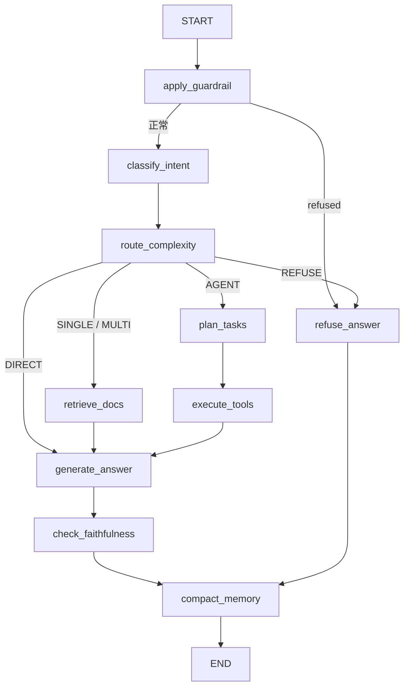

# P0-A — Architecture Audit

审计日期：2026-10-31（Asia/Taipei）。角色：Coding Agent；本 Session 先完成一次 Initializer，再只执行 P0-A。

源码基线：`2a12a62382a8c3ec033fa9a5b19b9b23b8780ab8`。初始化检查点：`d788492ead34b64390e706d6c95a739bf5c39cd7`。代码、测试和依赖均未修改；只新增/更新指定审计目录中的报告、状态和离线核查材料。

## 1. 范围、证据与结论

本报告审计实际执行链：FastAPI → ChatService → LangGraph → Nodes → Retriever / Tools → Generate → Memory → Response。只解释已存在的实现和结构缺口，不启动 P0-B～P0-G，不设计或实施后续业务功能。

| 标签 | 本报告中的含义 |
|---|---|
| SOURCE_VERIFIED | 已读取当前文件、调用位置和相关测试代码，并可由行号、符号和文件 SHA-256 复核。测试源代码存在不代表测试已执行 |
| TEST_VERIFIED | 仅用于本次实际安全执行的业务测试。本任务没有此类业务测试结果 |
| DOCUMENTED_ONLY | 仓库文档中的描述或历史结果；不作为当前运行证据 |
| HYPOTHESIS | 根据结构提出的影响或风险，尚未在真实运行、并发或模型条件下验证 |
| BLOCKED | 因 P0 禁止副作用或缺少隔离运行条件而没有执行的验证；不表示已证伪 |

**SOURCE_VERIFIED：** 项目是共享 Provider、Retriever、ToolRegistry 的状态图客服服务。图在 ChatService 创建时编译一次；HTTP 每轮创建请求作用域的数据库 Session。五策略控制检索或工具路径，最后生成、校验、压缩并持久化。依据：[ChatService.__init__:43](../../../../app/services/chat_service.py#L43)、[build_graph:45](../../../../app/agents/graph.py#L45)、[request_session:28](../../../../app/core/request_scope.py#L28)。

**SOURCE_VERIFIED：** 当前不是模型原生 tool_calls 驱动的 ReAct 循环，也没有图级 checkpoint 恢复；SSE 正文不是直接透传模型 Token；保存历史不等于历史已经进入生成 Prompt。以下逐项给出证据。

## 2. 入口、启动与依赖生命周期

| 顺序 | 实际源文件、函数和行号 | 行为与边界 |
|---|---|---|
| 1 | [app/asgi.py:5](../../../../app/asgi.py#L5)，模块级 `app = create_app()` | Uvicorn 的 `app.asgi:app` 加载对象；不能把 main.py 当作独立服务器脚本 |
| 2 | [main.create_app:42](../../../../app/main.py#L42) | 创建 FastAPI，注册 health/chat/admin，中间件、统一错误响应、`/metrics`；构建前端存在时挂载静态文件 |
| 3 | [main.lifespan:30](../../../../app/main.py#L30) | 配置日志、调用 build_container，把实例放入 app.state；退出时 aclose |
| 4 | [container.build_infrastructure:62](../../../../app/services/container.py#L62) | 建 Engine，执行 init_schema，再建 Session factory，连接可选 Redis |
| 5 | [db.init_schema:42](../../../../app/repositories/db.py#L42) | 使用 `Base.metadata.create_all`，是可能写数据库的初始化；因此本次不启动应用 |
| 6 | [container.build_retrieval:71](../../../../app/services/container.py#L71) | 选择 Embedder，建短 TTL 缓存，解析/编码知识并入库，组装 HybridRetriever、Reranker |
| 7 | [container.build_container:94](../../../../app/services/container.py#L94) | 选 DeepSeek/Offline，组装限流、注册表与外部工具，创建 ChatService；seed 默认 false，仅显式 true 才写演示数据 |
| 8 | [ChatService.__init__:43](../../../../app/services/chat_service.py#L43) | 持有共享组件和待确认内存字典，调用 build_graph 一次；没有把数据库 Session 编译进图 |
| 9 | [AppContainer.aclose:51](../../../../app/services/container.py#L51) | 关闭 LLM、Redis、Engine；没有统一调用远程 Embedding 或 Qdrant 的 close |

上述调用关系均为 SOURCE_VERIFIED；本机数据库连接、模型是否实际可加载及退出时资源状态均未运行验证。

补充入口：CLI [ChatCli.setup:56](../../../../app/cli/client.py#L56) 优先连接既有 API，失败时可在本进程 build_container；[ChatCli._chat_local:89](../../../../app/cli/client.py#L89) 直接调用 ChatService，不经过 HTTP 中间件。Docker [Dockerfile](../../../../Dockerfile) 以 Uvicorn 启动服务。后续追踪必须区分 HTTP 与本地 CLI 入口，不能假设每次调用都先执行 HTTP 中间件。

**已确认的配置边界：SOURCE_VERIFIED。** `create_app(settings)` 的 `resolved` 用于路由等配置，但 `lifespan()` 重新调用 `get_settings()`；显式传入的 Settings 没有直接交给容器（[main.py:56](../../../../app/main.py#L56)、[main.py:32](../../../../app/main.py#L32)）。两处配置可能分离是结构事实；具体测试/部署影响为 HYPOTHESIS，未运行覆盖注入场景。

## 3. 普通 HTTP 请求的真实顺序

以下调用链为 SOURCE_VERIFIED。

```text
POST /api/v1/chat
  main.request_context：绑定 trace_id/request_id
  routes.chat.chat：请求 Schema + get_container
  ChatService.chat
    限流（在计时起点之前）
    生成或复用 session_id
    request_session：绑定本请求 DB Session
    _initial_state：确认校验 → 获取/创建 session → 最近消息
    _invoke → graph.ainvoke
    _to_response：仅映射公开响应字段
    _persist：追加本轮原始 user/assistant 消息，可保存 summary
    db.commit
    _remember_pending：记录本轮待确认动作
    _observe：设置总延迟、更新聚合 Metrics、完成日志
    返回 ChatResponse
```

定位：[request_context:72](../../../../app/main.py#L72)、[chat route:15](../../../../app/api/routes/chat.py#L15)、[ChatService.chat:70](../../../../app/services/chat_service.py#L70)、[_initial_state:161](../../../../app/services/chat_service.py#L161)、[_persist:232](../../../../app/services/chat_service.py#L232)、[_to_response:246](../../../../app/services/chat_service.py#L246)、[_observe:271](../../../../app/services/chat_service.py#L271)。

`ChatRequest.stream` 是 Schema 字段，但此处没有据它切换执行模式；实际采用 `/chat` 还是 `/chat/stream` 路由决定两种入口（[ChatRequest:18](../../../../app/schemas/chat.py#L18)、[chat routes:14](../../../../app/api/routes/chat.py#L14)）。

数据库事务从初始会话读取/flush 跨越整个图执行到最终提交。ContextVar 保证工具取到本请求 Session，不代表已经缩短事务，也不保证所有并发业务状态变更具备串行化语义。前者为 SOURCE_VERIFIED；连接占用、SQLite 锁等待和并发后果为 HYPOTHESIS，本次不压测。

## 4. LangGraph 节点与分支

图构建和边定义依据：[build_graph:45](../../../../app/agents/graph.py#L45)、[_route_after_complexity:33](../../../../app/agents/graph.py#L33)、[边定义:83](../../../../app/agents/graph.py#L83)。



| 图节点 | Handler / 实际实现位置 | 读取与输出摘要 |
|---|---|---|
| apply_guardrail | [guardrail_node:9](../../../../app/agents/nodes/guardrail.py#L9) | 扫描 user_query；异常转 refused、REFUSE、error。当前只调用注入检测，不直接调用独立 boundary 函数 |
| classify_intent | [intent_node:19](../../../../app/agents/nodes/router.py#L19) → [IntentClassifier.classify:77](../../../../app/agents/nodes/intent.py#L77) | 本轮问题 → IntentResult、intent_ms；在线先 LLM，再覆盖规则；离线/失败走规则 |
| route_complexity | [router_node:27](../../../../app/agents/nodes/router.py#L27) → [AdaptiveRouter.route:135](../../../../app/retrieval/adaptive.py#L135) | 本轮问题和意图 → complexity、strategy、query_complexity、routing_ms；confirmed_action 强制 AGENT |
| retrieve_docs | [retrieval_node:18](../../../../app/agents/nodes/retrieval.py#L18) | 按策略选择单轮或 Self-RAG，输出 retrieved_chunks、rewritten_queries、retrieval_ms |
| plan_tasks | [planner_node:169](../../../../app/agents/nodes/planner.py#L169) | query/intent/summary 或 confirmed_action → plan、pending_action，缺订单号时输出 extra 标记 |
| execute_tools | [executor_node:95](../../../../app/agents/nodes/executor.py#L95) | 顺序遍历 plan.steps，输出 tool_results、step_count、tool_ms；未确认 pending 时整段计划跳过 |
| generate_answer | [generate_node:27](../../../../app/agents/nodes/generate.py#L27) | 证据/工具/当前问题 → final_answer、citations 等；存在 pending 时直接返回确认摘要 |
| refuse_answer | [refuse_node:123](../../../../app/agents/nodes/generate.py#L123) | 固定越界拒答正文、refused、空引用；会覆盖护栏节点先设置的通用拦截正文 |
| check_faithfulness | [faithfulness_node:73](../../../../app/agents/nodes/faithfulness.py#L73) | 校验或自纠错正文，写入 extra 中的判定；DIRECT/离线/pending 等跳过检查 |
| compact_memory | [memory_node:11](../../../../app/agents/nodes/memory.py#L11) | 追加本轮消息、压缩、可选摘要 → messages、tool_results、summary；不是生成前上下文构建器 |

表中行为均为 SOURCE_VERIFIED。外层图没有回边；补检发生在 SelfRAGLoop.retrieve 内，修复回答发生在 self_correct_answer 内。`graph.compile()` 未传 checkpointer；当前持久化消息不能替代图执行检查点（[graph.py:110](../../../../app/agents/graph.py#L110)）。

## 5. State 与数据边界

`AgentState` 是 `TypedDict(total=False)`，定义见 [state.py:12](../../../../app/agents/state.py#L12)，没有配置 `Annotated[add]` 一类 reducer。按当前声明设计，节点做字段部分替换，列表追加和跨轮恢复必须由业务代码完成；它不是完整运行时 Pydantic 校验器。SSE 还用 `holder['merged'].update(payload)` 手工合并节点更新（[chat_service.py:97](../../../../app/services/chat_service.py#L97)）。

| 状态组 | 首次写入 / 后续读取 | 已核实边界 |
|---|---|---|
| trace_id / session_id / user_id / user_query | `_initial_state` → 节点、ToolContext、Response | trace ID 是关联信息，user_id 来自请求；不等于认证身份 |
| messages / summary | 最近消息 → memory_node；Planner 接收 summary 参数 | `_initial_state` 每轮令 summary 为空；generate_node 没有使用 messages/summary；后续交给 P0-B 详细审计 |
| intent / complexity / strategy | 分类、路由 → 检索、规划、生成 | 确认动作只绕过复杂度判断，不绕过更前面的护栏和意图节点 |
| rewritten_queries / retrieved_chunks | retrieval_node → generate、faithfulness | MULTI 只把原问题记录到 rewritten_queries，内部完整改写与 grade 不在公开 State 中 |
| plan / tool_results | Planner → Executor → Generate / Checker | 没有通用的“上一步输出绑定下一步参数”或执行后返回 Planner 的边 |
| pending_action / confirmed_action / confirm_action_id | Planner 或确认恢复 → Executor / Generate | ActionProposal 存在本进程内存，不是 SQL 会话摘要，也不是框架 interrupt/checkpoint |
| extra | Planner 或 Faithfulness | 字段替换语义；诊断信息没有全部映射到 ChatResponse |
| token_usage / latency / step_count | 各节点部分更新 → Response / Metrics | usage 主要由 generate 累计，不能据字段存在推断已统计每个 LLM 调用 |

依据：[初始化:168](../../../../app/services/chat_service.py#L168)、[Planner 输入:186](../../../../app/agents/nodes/planner.py#L186)、[生成 Prompt:68](../../../../app/agents/nodes/generate.py#L68)、[Response 映射:256](../../../../app/services/chat_service.py#L256)、[Token 更新:108](../../../../app/agents/nodes/generate.py#L108)。全部 SOURCE_VERIFIED；跨轮能力效果未测试。

## 6. Prompt 实际注入位置与 Provider

| 用途 | 模板文件 | 实际构造并调用的位置 |
|---|---|---|
| 意图 | [prompts/intent.py:29](../../../../app/prompts/intent.py#L29)，INTENT_SYSTEM / INTENT_USER | [IntentClassifier.classify:82](../../../../app/agents/nodes/intent.py#L82)，system + 当前 query/version；无历史 |
| 复杂度 | [prompts/complexity.py:3](../../../../app/prompts/complexity.py#L3) | [AdaptiveRouter.route:140](../../../../app/retrieval/adaptive.py#L140)，当前 query/intent/version |
| 查询改写 | [prompts/query_rewrite.py:3](../../../../app/prompts/query_rewrite.py#L3) | [QueryRewriter.rewrite:16](../../../../app/retrieval/query_rewrite.py#L16)，query + missing_aspect |
| 证据充分性 | [prompts/self_rag.py:3](../../../../app/prompts/self_rag.py#L3) | [SelfRAGLoop._grade:72](../../../../app/retrieval/self_rag.py#L72)，前 6 条累积证据 |
| 规划 | [prompts/planner.py:3](../../../../app/prompts/planner.py#L3) | [Planner.create_plan:47](../../../../app/agents/nodes/planner.py#L47)，文字工具目录、Skill、query/intent/summary；不是原生工具 Schema 请求 |
| 回答 | [prompts/answer.py:5](../../../../app/prompts/answer.py#L5) | [generate_node:49](../../../../app/agents/nodes/generate.py#L49)，前 6 条检索切片和工具结果 JSON；system 含不可信上下文声明 |
| 忠实度 | [prompts/faithfulness.py:3](../../../../app/prompts/faithfulness.py#L3) | [FaithfulnessChecker.check:24](../../../../app/guardrails/hallucination.py#L24)，回答、前 8 条切片和工具结果 |
| 自纠错 | [prompts/faithfulness.py:21](../../../../app/prompts/faithfulness.py#L21) | [self_correct_answer:33](../../../../app/agents/nodes/faithfulness.py#L33)，旧答案、critique、前 6 条证据和工具结果 |
| 摘要 | [prompts/summary.py:3](../../../../app/prompts/summary.py#L3) | [ConversationSummarizer.summarize:14](../../../../app/memory/summarizer.py#L14)，收到的最后 16 条消息转文本 |

全部 SOURCE_VERIFIED。模板定义不等于自动注入；表中右列才是模型实际收到内容的构造位置。没有发现自动把长期用户记忆或已审核经验注入以上 Prompt 的现有链路；是否新增由后续 P0-B/P0-E 单独研究。

DeepSeekProvider 使用自定义 httpx AsyncClient：[__init__:27](../../../../app/providers/deepseek.py#L27)；[generate:48](../../../../app/providers/deepseek.py#L48) 发往 `/chat/completions`，请求字段为 model/messages/temperature/max_tokens/可选 response_format；响应解析 choices 和 usage。没有发送工具 Schema 或解析原生 tool_calls。Provider 协议见 [LLMProvider:30](../../../../app/providers/base.py#L30)，结构化结果解析见 [parse_model:46](../../../../app/providers/json_parser.py#L46)。

`generate()` 调用 [with_exponential_backoff:32](../../../../app/core/retry.py#L32) 重试暂时性异常；若 HTTP JSON 本身无法解析，`response.json()` 不在 choices 结构检查的 try 内，不应宣称任意畸形响应都已统一降级。该代码属性为 SOURCE_VERIFIED；此异常输入的实际 API 行为为 HYPOTHESIS，未执行注入测试。

Provider 的 [stream:114](../../../../app/providers/deepseek.py#L114) 有原始增量接口，但 ChatService 的用户 SSE 路径没有调用它。Provider 的 [ping:44](../../../../app/providers/deepseek.py#L44) 只检查密钥非空，不能证明远端模型可达。

## 7. Retriever 链：建索引、召回、精排、补检

### 7.1 启动建索引

`build_retrieval → ingest_knowledge → KnowledgeIngestor.load → parse_path → dedupe_chunks → embed → build_records`，随后构建 BM25 与向量 Store。文件解析和 Qdrant 同步调用使用 `asyncio.to_thread`。依据：[KnowledgeIngestor.load:79](../../../../app/retrieval/ingest.py#L79)、[ingest_knowledge:116](../../../../app/retrieval/ingest.py#L116)。

SOURCE_VERIFIED：每个 API 进程启动都会执行这一装配流程，不是简单读取一个预发布索引。Qdrant 路径可能建 collection/upsert；本次不执行。相对路径文档 ID 已存在：[document_id_from_path:23](../../../../app/retrieval/chunking.py#L23)，因此旧文档若声称仍依赖绝对路径，不属于当前事实。

### 7.2 SINGLE / MULTI 与工具检索

- **SINGLE：SOURCE_VERIFIED。** [retrieval_node:38](../../../../app/agents/nodes/retrieval.py#L38) 最多采用原问题加一条改写，依次 Hybrid.retrieve，按 chunk_id 合并，再用原问题精排；“单跳”不等于只访问检索器一次。
- **Hybrid：SOURCE_VERIFIED。** [HybridRetriever.retrieve:37](../../../../app/retrieval/hybrid.py#L37) 先查缓存，未命中依次 BM25.search、VectorRetriever.search，再 [reciprocal_rank_fusion:16](../../../../app/retrieval/fusion.py#L16)，融合后截 top_k、缓存。两路不是当前显式并行任务。
- **Dense：SOURCE_VERIFIED。** [VectorRetriever.search:161](../../../../app/retrieval/vector.py#L161) 先 embed 查询，再在线程执行 store.search；Store 为内存或 Qdrant。
- **精排：SOURCE_VERIFIED。** [DocumentReranker.rerank:13](../../../../app/retrieval/reranker.py#L13) 调用 Provider 并映射原候选索引；[CrossEncoderRerankProvider.rerank:107](../../../../app/providers/reranker.py#L107) 线程化 predict。加载失败走 lexical 回退。
- **MULTI：SOURCE_VERIFIED。** [SelfRAGLoop.retrieve:44](../../../../app/retrieval/self_rag.py#L44) 默认按配置有限轮改写/召回/精排/grade；sufficient 结束，不充分以 missing_aspect 再检；按字典插入顺序返回有界累积列表，没有最终全局精排。
- **AGENT 的政策工具：SOURCE_VERIFIED。** [SearchKnowledgeTool.execute:51](../../../../app/tools/knowledge_tools.py#L51) 直接 Hybrid top_k=4，再把节选装入 ToolResult.output.chunks；它不等价于 retrieve_docs 节点，也不把结果自动复制到 State.retrieved_chunks。因此正文可用工具里的政策，公开 Citation 列表却不自动获得同样引用。

默认参数可在 [Settings:10](../../../../app/config/settings.py#L10) 核对：simple_k=3、complex_k=8、rrf_k=60、rerank_top_n=5、max_retrieval_hops=3。取默认值不能证明部署时未被环境覆盖。

## 8. Tool Calling、Handler 与人工确认

当前调用形态为 SOURCE_VERIFIED：

```text
Planner.create_plan
  match_skill → 文本工具目录 / Skill 提示
  LLM 输出 AgentPlan JSON → parse_model → _sanitize_plan
  planner_node 筛选显式写请求 → 可生成 ActionProposal
Executor
  registry.get(name) → Tool.run(arguments, context)
  input_model.model_validate → 具体 Tool.execute
  RepositoryBackedTool.repository → 当前请求 OrderRepository
  Repository 查询/写入/flush → ChatService 统一 commit
```

依据：[Planner.create_plan:37](../../../../app/agents/nodes/planner.py#L37)、[_sanitize_plan:97](../../../../app/agents/nodes/planner.py#L97)、[Tool.run:70](../../../../app/tools/base.py#L70)、[Tool.parse:59](../../../../app/tools/base.py#L59)、[RepositoryBackedTool.repository:14](../../../../app/tools/deps.py#L14)。[Tool.openai_schema:84](../../../../app/tools/base.py#L84) 与 [ToolRegistry.openai_tools:25](../../../../app/tools/registry.py#L25) 可以导出 Schema，但能力存在不证明主规划链使用原生 Function Calling。

15 个核心 Handler 在 [build_tool_registry:28](../../../../app/tools/factory.py#L28) 显式注册。默认外部工具适配再加本地目录项目，数量不固定为 15。Skill 来自 [match_skill:37](../../../../app/skills/loader.py#L37) 和四份 JSON；它是业务流程提示/工具集合，不是具备结果变量绑定的执行 DSL。外部 HTTP 实现 [call_mcp_tool:53](../../../../app/mcp/runtime.py#L53) 直接发 `{name, arguments}`，本报告只确认此实现，不将其等同完整标准协议能力。

Handler 示例：订单 [GetOrderTool.execute:33](../../../../app/tools/order_tools.py#L33) → [get_visible_order:37](../../../../app/repositories/order_repository.py#L37)；取消 [CancelOrderTool.execute:125](../../../../app/tools/aftersale_tools.py#L125) → [cancel_order:123](../../../../app/repositories/order_repository.py#L123)，仅 CREATED/PAID 状态可取消；退款 [CreateRefundRequestTool.execute:79](../../../../app/tools/aftersale_tools.py#L79) → [create_refund:62](../../../../app/repositories/order_repository.py#L62)，写本地 requested 记录，不代表支付渠道退款完成。

确认是两个请求：第一次计划含 pending_action 时 Executor 直接返回空结果，整段计划内的读工具也不先执行（[executor.py:104](../../../../app/agents/nodes/executor.py#L104)）；本轮提交后 _remember_pending 存内存。第二次 [_resolve_confirmation:191](../../../../app/services/chat_service.py#L191) 验证 action_id、用户、会话和 15 分钟有效期；Planner 复用保存的原工具和参数，Executor 再检查 [assert_permitted:10](../../../../app/tools/permissions.py#L10) 和幂等。单进程待确认存储、先查后写幂等的并发/重启影响留 P0-F 验证，本次不执行订单写操作。

Executor 只有顺序遍历计划，没有逐步反馈重新规划的外层循环。失败可能成为 `ToolResult(success=False)` 而非整体 HTTP 错误；工具成功、回答可生成、数据库提交成功是不同状态（[executor_node:119](../../../../app/agents/nodes/executor.py#L119)、[generate_node:31](../../../../app/agents/nodes/generate.py#L31)）。

## 9. 生成、校验、Memory 与输出

所有分支在第 4 节图中可定位。以下均为 SOURCE_VERIFIED。

1. Generate 有确定性早返回：全工具失败、缺订单号、待确认动作；Offline 返回节选或白名单业务状态。在线正常路径才调用 LLM。
2. 首次生成用已召回 chunk_id 过滤引用；LLM 编造的 ID 不直接进入 Citation，但这不保证逐句引用正确（[generate.py:96](../../../../app/agents/nodes/generate.py#L96)）。
3. Faithfulness 判断后最多一轮模型重写，再尝试抽取式回退和复检；失败可拒答，checker_unavailable 走离线答案（[faithfulness_node:73](../../../../app/agents/nodes/faithfulness.py#L73)）。这不是持久化 Failure Reflection/Experience Memory。
4. 重写路径只取 AnswerPayload.answer；成功返回新正文时没有统一重建 citations/refused。这是源代码可见的状态更新缺口（[self_correct_answer:52](../../../../app/agents/nodes/faithfulness.py#L52)、[faithfulness_node:138](../../../../app/agents/nodes/faithfulness.py#L138)）；引用脱节的具体样本尚未运行。
5. Memory 发生在生成/拒答之后。它显式追加本轮消息，再 apply_compression；AUTO_COMPACT 时对已经返回的窗口做摘要。具体预算完整性和长期记忆设计留 P0-B，不在本任务制定（[memory_node:17](../../../../app/agents/nodes/memory.py#L17)、[apply_compression:50](../../../../app/memory/compression.py#L50)）。
6. `_persist()` 保存 request.message 与 response.answer，并在 summary 非空时更新 session；没有把 compact 后的 State.messages 替换为数据库完整消息表。下一轮按 Repository 最近 20 条重新读取，而非恢复完整图状态（[SessionRepository.recent_messages:23](../../../../app/repositories/session_repository.py#L23)、[_persist:232](../../../../app/services/chat_service.py#L232)）。
7. `_to_response()` 不公开完整 plan、tool_results、extra、hop grade；因此只保存 ChatResponse 不足以重建全部 Agent 执行。追踪选型与具体 Span 设计留 P0-D。

## 10. SSE 与普通路径的差异

定位：[chat_stream route:25](../../../../app/api/routes/chat.py#L25)、[ChatService.stream:84](../../../../app/services/chat_service.py#L84)。

| 项目 | 普通 chat | stream |
|---|---|---|
| 图调用 | `_invoke → ainvoke` | 内部 create_task 运行 astream(updates)，主协程经 Queue 发事件 |
| 状态合并 | Graph 返回最终 State | holder 字典逐项 update |
| 前置事件 | 无 | 初始状态完成后发送 started；逐节点发送 node，可带 intent/strategy |
| 正文 | 完整 JSON 回答 | 图和校验结束，消息 commit 后，按每 48 字符发送 token，再 answer、done |
| 特殊 GuardrailError | `_invoke` 转 State 并正常持久化 | worker 捕获后有独立 answer/done 返回；不走相同 _persist/_observe 分支 |
| 失败/取消 | AppError 可上抛至 HTTP handler | holder 保存异常再抛；finally 对未完成 task 调 cancel，但没有显式 await 被取消 task 的清理 |

前五行流程是 SOURCE_VERIFIED；流已发出后 HTTP 错误映射、取消清理与 ContextVar 在真实 ASGI 并发条件下的具体表现是 HYPOTHESIS。本次没有模拟断流；不能因为代码含 cancel 就宣称取消时事务与子任务生命周期已验证安全，也不能把当前 token 事件计作 Provider 的真实首 Token。

## 11. 错误处理与降级矩阵

| 场景 | 当前处理 | 证据 |
|---|---|---|
| 明显查询注入 | GuardrailError → refused / REFUSE → refuse_node | [guardrail_node:9](../../../../app/agents/nodes/guardrail.py#L9)、[detect_prompt_injection:19](../../../../app/guardrails/injection.py#L19) |
| 分类/路由输出或 Provider 错误 | 规则回退；意图仍应用 overlay | [IntentClassifier.classify:100](../../../../app/agents/nodes/intent.py#L100)、[AdaptiveRouter.route:165](../../../../app/retrieval/adaptive.py#L165) |
| 查询改写失败 | 使用原问题 | [QueryRewriter.rewrite:16](../../../../app/retrieval/query_rewrite.py#L16) |
| 没有生成密钥 | 容器选择 OfflineLLMProvider；对应节点使用离线行为 | [build_container:96](../../../../app/services/container.py#L96)、[OfflineLLMProvider:61](../../../../app/providers/fake.py#L61) |
| 本地 Embedding 加载不可用 | 构建时回退 Hash；已选择远程 API 时不存在同样的自动运行时切换链 | [build_embedding_provider:213](../../../../app/providers/embeddings.py#L213) |
| Qdrant 启动入库失败 | 使用内存向量库 | [ingest_knowledge:131](../../../../app/retrieval/ingest.py#L131) |
| BM25 或 Dense 单路失败 | 记录异常并尝试保留另一路 | [HybridRetriever.retrieve:47](../../../../app/retrieval/hybrid.py#L47) |
| 两路结果皆空 | 抛 RetrievalError；当前把正常空结果和后端错误汇到此出口 | [hybrid.py:57](../../../../app/retrieval/hybrid.py#L57) |
| Cross-Encoder 加载不可用 | lexical 排序回退；predict 阶段任意异常不保证走同样回退 | [CrossEncoderRerankProvider.rerank:107](../../../../app/providers/reranker.py#L107) |
| Self-RAG grade 失败 | 有 chunks 就视为 sufficient；不是已验证证据一定足够 | [SelfRAGLoop._grade:85](../../../../app/retrieval/self_rag.py#L85) |
| Planner 无有效计划/错误 | Skill 工具列表或知识工具 fallback | [Planner.create_plan:73](../../../../app/agents/nodes/planner.py#L73) |
| 读工具失败 | 尝试 READ_FALLBACKS，附 fallback_from/error | [execute_with_fallback:57](../../../../app/agents/nodes/executor.py#L57) |
| 写权限/幂等冲突等 AppError | 产生失败 ToolResult，并记录分类指标 | [executor_node:154](../../../../app/agents/nodes/executor.py#L154) |
| 生成失败 | 抽取式节选/无法可靠整理的说明 | [generate_node:90](../../../../app/agents/nodes/generate.py#L90) |
| Checker 不可用 | 返回 supported=false + checker_unavailable；在线节点识别后转离线答案 | [FaithfulnessChecker.check:52](../../../../app/guardrails/hallucination.py#L52)、[faithfulness_node:104](../../../../app/agents/nodes/faithfulness.py#L104) |
| Redis 启动连接失败 | 使用内存缓存和限流 | [connect_redis:12](../../../../app/infra/redis_client.py#L12)、[build_container:99](../../../../app/services/container.py#L99) |
| Redis 缓存运行错误 | get miss / set 记录日志；JSON 解析和对象验证不在 get 的 Redis try 中 | [RedisRetrievalCache.get:64](../../../../app/retrieval/cache.py#L64) |
| Redis 限流运行错误 | fail-open | [RedisRateLimiter.allow:50](../../../../app/infra/rate_limit.py#L50) |
| HTTP 请求校验/AppError/其他异常 | 422、稳定错误响应、通用 500；不保证处理已发出流内容后的错误 | [main.py:86](../../../../app/main.py#L86) |

表中处理位置为 SOURCE_VERIFIED；本次没有运行故障注入或远程依赖。降级保留可用性不等于保留同等质量。数据库 flush 失败后 Executor 虽可能返回失败结果，Session 能否继续持久化不应由异常转换推断为安全，需后续隔离故障验证。

## 12. 数据库、缓存与业务状态边界

**SOURCE_VERIFIED：** SQL 保存业务事实、session/message、审计和幂等键，模型定义见 [models.py](../../../../app/repositories/models.py)。订单工具先对比传入 user_id 的归属；ChatRequest 自带 user_id、路由未设置登录认证依赖，session 已存在时也不核对 owner（[ChatRequest:18](../../../../app/schemas/chat.py#L18)、[chat route:15](../../../../app/api/routes/chat.py#L15)、[SessionRepository.get_or_create:15](../../../../app/repositories/session_repository.py#L15)）。这是调用边界发现，具体严重性与攻击场景交给 P0-F；本任务不进行越权实测。

**SOURCE_VERIFIED：** 业务写入和审计只 flush，外层提交；幂等输出使用同一个请求 Session 存储（[OrderRepository.write_audit:139](../../../../app/repositories/order_repository.py#L139)、[IdempotencyRepository:12](../../../../app/repositories/idempotency.py#L12)、[executor_node:132](../../../../app/agents/nodes/executor.py#L132)）。当前先查 key 再执行和插入，不等于并发 exactly-once。该并发影响为 HYPOTHESIS，不能引用顺序测试就认定已解决。

**SOURCE_VERIFIED：** Redis/内存缓存只包 Hybrid 召回，不缓存所有回答或订单工具输出；key 仅 query + top_k，含 ORD 或中文“订单”的问题绕过（[cache_key:23](../../../../app/retrieval/cache.py#L23)、[_looks_like_order_query:18](../../../../app/retrieval/cache.py#L18)）。TTL 默认 60 秒，没有语料/模型/租户版本维度。知识更新与缓存一致性留后续审计，不在本任务清理任何缓存。

**SOURCE_VERIFIED：** 主服务输出有 trace_id、完成日志和聚合指标，但这些不能从公开 Response 还原全部调用。此处只说明调用出口，完整可观测性覆盖与 Span 选型留 P0-D，未接入任何服务。

## 13. 相关测试：核对了什么，没有声称什么

以下均为 **SOURCE_VERIFIED（仅阅读测试代码，未运行）**，不是 TEST_VERIFIED。

| 测试与符号 | 当前断言覆盖 | 不能由它推导的结论 |
|---|---|---|
| [test_health_and_chat_greeting:14](../../../../tests/e2e/test_chat_api.py#L14) | HTTP 基础响应、trace_id、answer、响应头 | 未验证所有五路、真实远端模型或并发 |
| [test_injection_is_refused:28](../../../../tests/e2e/test_chat_api.py#L28) | 一个明显注入样本被拒答 | 不能证明任意注入/间接文档注入被防住 |
| [test_chat_stream_emits_token_and_node_events:48](../../../../tests/e2e/test_chat_api.py#L48) | started、node/token、answer、done，拼接正文等于最终回答，不泄露假分类 JSON | 未断言 token 在生成时逐个到达，也未覆盖断连、取消、流中异常 |
| [test_greeting_goes_direct:7](../../../../tests/unit/test_adaptive_router.py#L7) 等 | 规则复杂度的 DIRECT/AGENT/MULTI 和一般政策纠偏 | 不是完整模型路由正确率或图级分支覆盖 |
| [test_loop_hops_again_and_dedupes_chunks:94](../../../../tests/unit/test_self_rag.py#L94) 等 | Fake/Stub 的轮次、去重、充分性停止、降级和截断 | 不证明真实多条件证据覆盖与最终答案质量 |
| [test_cancellation_needs_explicit_request_and_confirmation:25](../../../../tests/unit/test_action_confirmation.py#L25) | 生成提案、一般政策不提案、确认后复用原参数 | 不是两次完整 HTTP 请求后的业务终态测试 |
| [test_confirmation_is_bound_to_session_and_user:45](../../../../tests/unit/test_action_confirmation.py#L45) | 内存确认记录的用户/会话绑定 | 不证明用户身份已认证、记录跨实例共享 |
| [test_read_tool_falls_back_to_knowledge:37](../../../../tests/unit/test_executor_fallback.py#L37) | 失败读工具替换、结果名和 fallback_from | 不证明每个 fallback 的语义等价与任务完成 |
| [test_refund_is_idempotent_and_transactional:34](../../../../tests/integration/test_orders.py#L34) | 内存 SQLite 中顺序写退款/保存和读取幂等结果，提交后退款记录数为 1 | 没有并发调用同一写动作，也没有异常回滚注入；测试名称不能扩大证据范围 |
| [test_order_is_scoped_to_owner:50](../../../../tests/integration/test_orders.py#L50) | 传入另一 user_id 时订单工具报 not found | 不证明请求身份不可伪造或 session owner 已核验 |
| [test_refund_tool_persists_via_repository:90](../../../../tests/integration/test_orders.py#L90) | Tool.run 经 Repository 写 requested 记录并可查询 | 不证明真实支付退款、所有业务终态或确认链已端到端验证 |
| [test_offline_answer_quotes_evidence_instead_of_test_json:22](../../../../tests/unit/test_offline_answer.py#L22) | 离线节选和引用，不展示测试 JSON | 不证明在线生成质量 |
| [test_self_correct_rewrites_unsupported_answer:27](../../../../tests/unit/test_self_correct.py#L27) | Fake LLM 返回修复正文后 checker 判通过 | 未断言修复后 Citation 重建；不证明真实裁判可靠性 |

不执行 pytest 的依据：[tests/conftest.py:5](../../../../tests/conftest.py#L5) 会设置测试环境和 `data/local/test.db`，并 mkdir；HTTP TestClient 进入应用 lifespan 后会执行 schema 初始化和知识装配。虽然订单集成测试自身使用内存数据库，本次不改 conftest、不写业务目录、不运行 schema 创建，因此没有用 pytest/collect-only 当作“无副作用读取”。只运行审计目录内的标准库静态核查程序。

文档交叉依据：[docs/03-architecture.md](../../../../docs/03-architecture.md)、[docs/05-agents-and-tools.md](../../../../docs/05-agents-and-tools.md) 为 DOCUMENTED_ONLY。其分层说明可作导航；历史“Token 流式”“三个 Skill”等概括不能覆盖当前四份 Skill、SSE 分段和实际 Handler 证据。没有采用旧报告或聊天结论替代本次源码核对。

## 14. 可复用组件与后续审计交接

| 可复用资产 | 已确认的边界 | 后续单任务 |
|---|---|---|
| ChatService + 显式 Graph 节点 + Provider 协议 | 调用层次明确，但公开 Response 没有完整执行记录 | P0-D 审计调用级追踪，不在本次选型或接入 |
| SessionRepository、messages/summary 字段、压缩与摘要组件 | 组件存在，历史/摘要实际输入链未闭环 | P0-B 核对上下文与 M0–M3，不在本次重构 |
| ToolRegistry、参数模型、风险标记、确认恢复 | 可以作为后续工具轨迹和约束验证边界 | P0-C/P0-F 分别核对评测与风险 |
| SQL 审计/幂等、Qdrant、Redis | 各自当前用途清楚，不能据组件存在宣称有 Experience Memory | P0-E 评估经验库复用，不写经验或 Prompt |
| Fake Provider、Stub 检索、现有节点单测 | 可作为隔离验证基础，不能替代真实 E2E 证据 | P0-C 确定评分可靠性和隔离运行方案 |

本任务已经证实但尚未实测影响的优先交接点：配置注入两处来源、历史/摘要未进入 Generate、单进程待确认状态、修复后引用未统一重建、SSE 取消清理与数据库事务生命周期。它们只是 P0-A 的架构发现，不构成 P0-B～P0-F 已完成。

## 15. 验证与限制

可重复执行的验证程序：[evidence/validate_p0_a.py](../evidence/validate_p0_a.py)。结果文件：[evidence/P0-A-validation.json](../evidence/P0-A-validation.json)，源码与测试位置索引：[evidence/P0-A-source-index.json](../evidence/P0-A-source-index.json)。

静态核查内容：Markdown 引用路径/行号、当前 AST 符号、10 个 Graph 节点和边、Prompt 注入调用点、SSE 时序的代码结构、任务验收条目与输出存在性、初始化前 329 个已跟踪文件及 19 个预存未跟踪文件的 SHA-256 完整性。PASS 仅指这些静态检查，不是业务测试通过或线上性能达标。

BLOCKED / 未运行：应用启动、模型 API、模型下载、真实检索质量评测、pytest、数据库迁移/建表、真实订单写入、并发及断流故障注入。原因是本次审计不允许这些副作用，且不通过改配置/测试获得隔离环境。本次不提供运行延迟、Token 成本、质量收益或安全攻击成功率的数值。

P0-A 的 passes 仅在本报告与证据文件存在、六条验收标准通过静态核查后设置；提交 hash 由状态文件记录。P0-B～P0-G 保持 pending / false；P0 总报告只在 P0-G 生成，当前不创建占位结论。下一 Session 必须从 AGENTS.md、feature-list.json、progress.txt、git log 恢复，首个就绪任务应为 P0-B。
