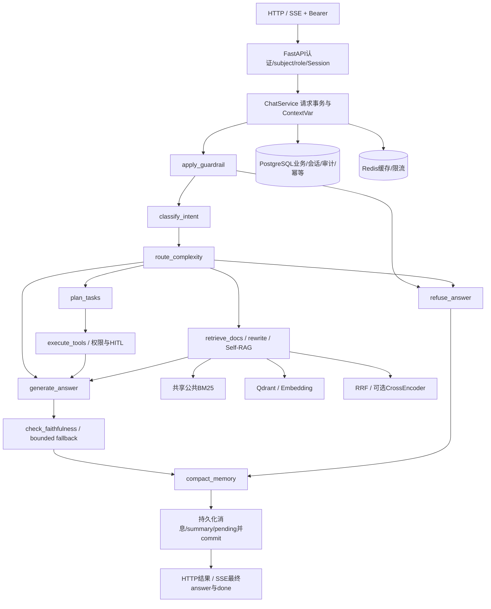

# Adaptive-RAG 项目最终交付摘要

本项目交付一个可在Ubuntu隔离环境复现的FastAPI/LangGraph客服Agent：公共知识检索、合成订单查询、Owner/Session隔离、HITL写前确认、事务/幂等/审计、Memory与可观测性。工程验证、真实模型质量和生产条件分别记录；本次**不是无条件生产验收PASS**。

## 历史证据与结论

| 阶段 | 已验证内容 | 质量/边界 | 入口 |
|---|---|---|---|
| P0 | 真实调用链、Prompt/HTTP/Graph与基线审计 | 审计完成不等于Agent质量达标 | [审计](../P0_AUDIT_REPORT.md) |
| P1 | bounded tracing、本地离线评估、原212项测试通过 | 原P1-F passes=false/PARTIAL保留；SaaS及当时uv/真实模型未完成，旧push失败记录未重写 | [P1报告](../P1_REPORT.md) |
| P2 | M0/M1/M2上下文、增量摘要、Planner/工具目标、回答契约 | 多轮真实质量PARTIAL；旧Gold与失败成绩保留 | [P2](../P2_REPORT.md)、[P2-Q](../p2_quality/P2-Q_FINAL_REPORT.md)、[P2-R](../p2_agent_quality/P2-R_FINAL_REPORT.md)、[P2-S](../p2_answer_reliability/P2-S_FINAL_REPORT.md) |
| P3-A/B | shadow候选/隔离Experience资格、检索注入及人工校准导入 | 7条历史用户标签不是D答案标签或经验批准；Experience收益未建立、Active关闭 | [P3-A](../p3_experience_shadow/P3-A_FINAL_REPORT.md)、[P3-B](../p3_experience_validation/P3-B_FINAL_REPORT.md) |
| P4-A | Uvicorn真实TCP、HTTP/SSE/工具受控E2E | SQLite/受控LLM，不等于真实依赖/语言质量 | [报告](../p4_api_e2e/P4-A_FINAL_REPORT.md) |
| P4-B | required Bearer、真实PG/Redis/Qdrant、并发幂等、durable HITL/restart、故障恢复 | bounded工程通过；Qdrant原SDK过滤测试不等于应用租户隔离 | [Ubuntu报告](../p4_dependency_integration/UBUNTU_FINAL_REPORT.md) |
| P4-C | 真实DeepSeek业务HTTP/SSE及预算账本 | 开发1/2、独立5/6机械proxy；CT06原失败保留，最小修复后D新场景验证；完整语义未知 | [报告](../p4_real_llm_e2e/P4-C_FINAL_REPORT.md) |
| P4-D | 新真实HITL基线、真实BGE/CrossEncoder、4组配对/14臂 | 小样本Memory受限收益；RAG下游收益未建立；无当前合格经验，E0/E2未运行；完整语义未知 | [报告](../p4_ablation_evaluation/P4-D_FINAL_REPORT.md) |
| P4-E | 最终安全/可靠性、实际ASGI部署、受控性能、回归与交付 | 日志缺陷修复；私有租户KB隔离FAIL、Redis fail-open与生产条件未认证 | [验收报告](P4-E_FINAL_REPORT.md) |

`feature-list.json`的旧任务通过字段保持原义，不能因E交付而把旧PARTIAL或NOT_RUN改PASS。早期网络/权限障碍以当时证据为准；当前分支Git交付单独核验。完整阶段审计见 `evidence/e0_phase_audit.json`、`evidence/e3_audit_reconciliation.json`。

## 系统与LangGraph

未解析历史实体的澄清可以绕过正常分类直接生成澄清。Graph实现以 `app/agents/graph.py` 为准；该图省略支路细节，不是服务调用时序或独立微服务部署图。

- **Memory**：M0关闭历史、M1近期、M2近期+owner-bound增量抽取摘要；SQL消息/summary跨worker可见，TTL与上下文预算约束。摘要不是持久事实，实时工具事实优先。D不验证真实长对话自然摘要质量。
- **RAG**：公共语料解析/清洗/分块，BM25与Dense经RRF，按实际配置可用真实CrossEncoder。模型不可用会降级；capabilities必须核对。当前ingest、BM25、vector和cache没有统一私有租户ACL。
- **Tools**：注册schema→参数校验→subject作用域repository→受限业务动作；只读查询不应改变业务表。SQL注入/宽查询依赖参数绑定与Owner检查，不让LLM发任意SQL。
- **HITL**：提案不写业务；pending confirmation在同库持久化，校验owner/session/expiry；确认时行锁覆盖业务与幂等commit。重复/并发/重启重放的单次取消通过新真实测试；断电灾难恢复未知。
- **Experience**：候选来源/生命周期/资格与隔离注入独立于业务Memory。没有当前资格经验时不注入；生产Active始终关闭。不把匹配准确率称为任务收益。
- **回答与SSE**：最终回答经受限faithfulness/回退后输出；SSE发进度与最终answer/done。模型Judge不是人类真值；工具成功不能代替事实/完整性/忠实度语义。
- **可观测性**：request/trace上下文、工具/Graph spans、Prometheus及错误envelope。E修复配置日志handler的格式化Bearer、嵌套字段和异常DSN脱敏；自有handler及任意无标签secret仍需约束。

## 测试与指标解释

单元测试验证解析、认证、工具、评分器和错误路径；SQLite集成不代替PostgreSQL；真实依赖集成验证迁移、TTL、过滤原语、事务和故障；TCP API矩阵验证HTTP/SSE/Owner/HITL；真实DeepSeek任务另有预算账本和冻结版本。受控LLM只验证流程及应用开销，不计为真实任务质量样本。全量pytest和冻结214历史回归在本次E3重新执行，实际计数及命令见最终报告。

D已有账本79请求/45050 Token/US$0.0178215峰值上界；C已有36/24393/US$0.0093708。两阶段合计115/69443/US$0.0271923，仅覆盖C+D，非项目所有历史账单。E新增付费请求为0；没有使用新的价格估计生成账单，不重新调用模型。实际invoice未知。

当前48次热请求性能为每格12个固定只读任务、单API进程、并发1/4，资源采样窗口很短。不得据此承诺生产QPS/SLO。真实BGE加载/IR与DeepSeek延迟独立引用D/C证据，不混入受控HTTP平均值。

## 可直接交接的材料

- [部署与测试命令](DEPLOYMENT_GUIDE.md)
- [20条原始交互的人工审核包](SEMANTIC_REVIEW_PACKET.md)与 [空白CSV](semantic_review_template.csv)
- [恢复与停止条件](RECOVERY.md)
- [P4-E最终报告](P4-E_FINAL_REPORT.md)、`evidence/`、Git任务检查点

尚未完成的内容是交付的一部分：私有KB ACL、生产外围限流、TLS/备份/密钥运营、持续负载/新机器安装/OCI构建、开放回答语义与生产总体Memory/RAG/Experience收益。没有用工程测试掩盖这些未知。

性能比较业务表时排除sessions/messages/pending_confirmations；原E2限制文字漏写pending，E3审查附录已披露，不能据该性能比较证明pending表不变。E1独立验证HITL提案及确认。
