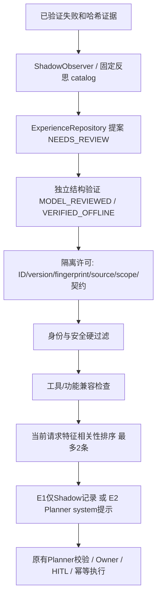

# Experience 架构与安全边界

沿用 P3 存储/审核/Shadow，不重构 Agent、RAG 或 M2。核心模块位于 `app/experience/`。

`reflection.py` 只对 VERIFIED_FAILURE 提取固定可迁移原则，不复制订单事实、凭据或任意原始提示。新增工具覆盖、参数/规划契约和最终回答覆盖三类。经验仍是建议，不能扩大工具权限或改写事实。

`compatibility.py` 记录工具输入 schema、风险、描述，以及 Owner/HITL/幂等/实体绑定实现摘要。兼容只说明抽样契约未变，不能覆盖全部实现或替代独立验证；兼容结果不修改审核状态。

`isolated.py` 按已验证精确 tenant/user/session、生命周期/到期/证据/许可进行拒绝式过滤，再做结构相关性排序。scope 来自 worker 验证的凭据主体和实际 session，客户端不能自报用户。许可绑定精确版本、内容、来源、作用域与目标契约。最多2条；公开 prepare_planner 自行选择验证，不接受任意未经筛选注入文本。生产无此 hook。

E0 消息不含经验；E1 选择结果只记录且消息哈希不变；E2 只有隔离测试 worker 调用 Planner 提示注入，保留原系统约束和工具 catalog。无资格则停止，不降级为随意提示。复用原工具执行路径，不能绕过 Owner、HITL 或重复写入保护。

新实验只读 SQLite SHA 固定；运行中新失败存另一 SQLite，仅 NEEDS_REVIEW，不反向污染正在评估的经验。结构资格来自独立 AI 测试，不冒充人工审批或真实收益。3原则×12精确scope=36副本，不扩大独立样本数。

生产 ExperienceSettings 仍仅 off/shadow，active 不受支持。本阶段没有生产主动学习、自动升级旧经验或产品化入口。未来产品化须另行授权并处理人工语义审核与现有回答 fallback 风险。
