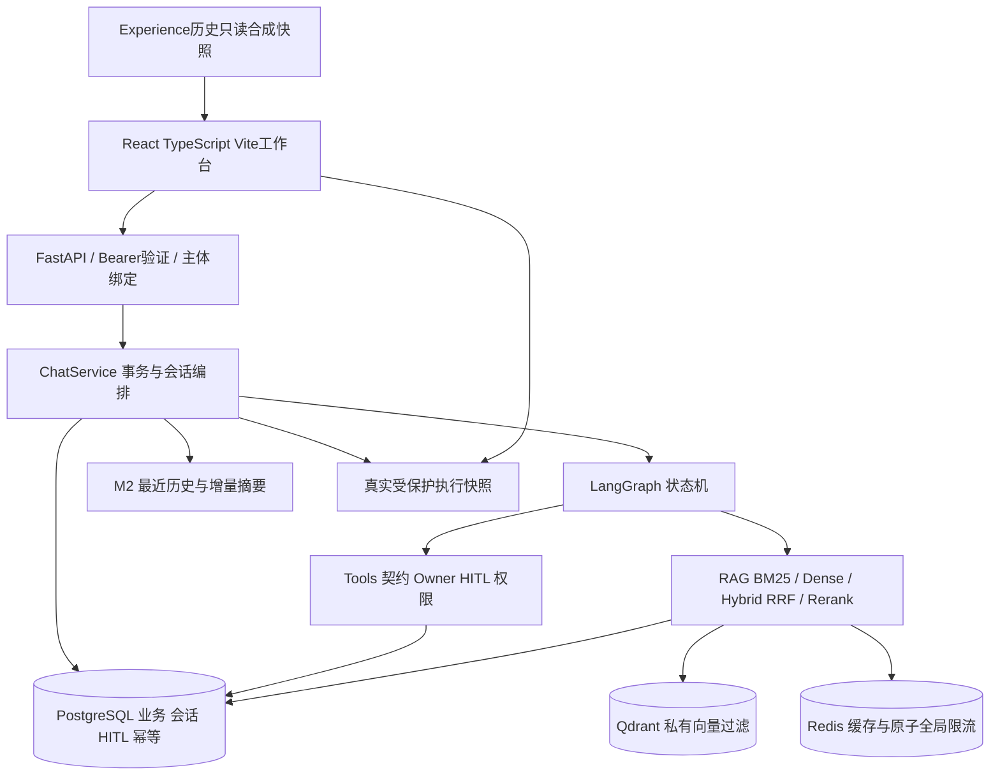
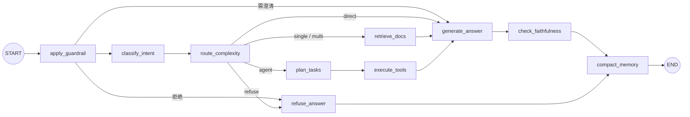

# 架构与模块职责

这是一个可审计的电商服务Agent工程示例：React工作台、FastAPI受保护API、LangGraph编排和真实依赖；不是多个自主Agent组成的生产集群。默认展示profile采用受控OfflineLLMProvider，无付费网络。

| 模块 | 责任与边界 |
|---|---|
| frontend/src | 身份只在内存、HTTP/SSE、会话、Markdown/引用、知识CRUD、HITL与真实Trace；不决定业务权限 |
| app/api + core/auth.py | 校验Bearer哈希注册表，服务端绑定subject；拒绝伪造身份；无生产登录/发证接口 |
| services/chat_service.py | request-scoped DB、上下文选择、graph调用、持久消息/提案、事务提交、限流；SSE只发最终校验回答 |
| agents/graph.py + nodes | guardrail/intent/router/retrieve/planner/executor/generate/faithfulness/memory状态机 |
| tools + repositories | 工具输入schema、Owner检查、HITL确认、幂等键/指纹和真实业务表操作；工具实时事实高于Memory |
| retrieval/private.py | 私有文档主体/版本/缓存/检索/引用/CRUD完整链路，不只在Qdrant加过滤 |
| memory | M0/M1/M2；演示M2，最近历史+有界增量摘要；M3偏好原型不作为已上线能力 |
| observability | 原有元数据span；Web快照128条、900秒，Owner/session/root绑定，非持久分布式Trace平台 |
| experience | 原P3存储/审核/Shadow，S1-EX隔离验证与Planner注入只在历史研究中；生产Active关闭 |
| scripts/showcase.py | 每run独立项目/凭证/进程，guarded init/serve/status/start/stop/browser，数据卷保留 |

## LangGraph 实际工作流

节点名来自实际graph.py；检查面板中的span短名由真正的traced节点产生。展示顺序是已完成节点，不伪造任意推理过程；计划不等于执行。写工具先返回待确认提案，确认后走原执行器，不能从UI绕过Owner/HITL/幂等。

私有RAG的文档正文与所有检索路径依赖服务端主体。Redis检索缓存绑定主体和版本，Qdrant元数据/过滤与SQL有效版本共同隔离。普通公共语料和private模式明确区分，private不可用不降级共享。

会话持久化使用已有SessionRow/MessageRow，Memory用于选择本轮上下文，不把历史回答当作当前订单事实。历史UI恢复若可用仅返回自己的user/assistant文本，不重建旧citation、Trace或pending权限。完整恢复状态以R4证据和最终报告为准。
