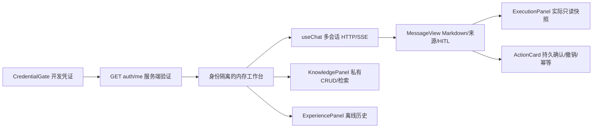

# S1-Web 前端架构

沿用 React19 + TypeScript + Vite；复用 lucide、react-markdown、remark-gfm、Sidebar/Composer/MessageView/SSE decoder。没有引入 UI 框架、全局状态库或改造 LangGraph/RAG/M2。

`lib/api.ts` 在内存持有 Bearer；凭证生命周期 AbortController 绑定所有 API 请求，身份切换中止旧请求，旧 401 不能清除新凭证。既有 localStorage 历史文件不读不写，避免跨主体混用；仅主题设置继续 localStorage。新对话列表最多50、每会话100条，页面刷新后重新认证并丢弃本次可见会话；业务会话仍在后端，暂无安全历史列表恢复能力。

`useChat` 用现有 reducer 保存服务端 session_id；客户端不发送 user_id/tenant_id。HTTP 和 SSE 使用同一响应契约；SSE真实节点事件即时显示，token 为最终校验和提交后的文本分块，不冒充模型原始流。取消仅停止接收，不代表业务回滚；超时120秒、网络/错误/EOF不自动重试。所有 Markdown 保持无 raw HTML 执行，来源按真实 citation 展示。

`KnowledgePanel` 复用 JSON 文档 API。上传只支持 UTF-8 .txt/.md、10000字符，更新需提交完整替换正文；本主体最多100篇。没有 PDF/Word/OCR 或组织共享入口。列表、检索、创建/更新/删除均有显式空/加载/成功/错误状态。

`ExecutionPanel` 按服务器生成 root_run_id +实际session查询。进程内128条、TTL900秒；不保证多进程路由或服务重启后的可见性。只展示实际完成节点、工具计划/有限参数、执行摘要、检索片段、Memory模式/历史计数/摘要使用与真实 span 耗时；无数据时显示不可用，不补造轨迹。原始提示、完整State、summary、异常文本和凭据不进入视图。

`ExperiencePanel` 静态导入经过挑选的合成历史快照，来源指向 S1-EX 已提交原件与SHA。历史 MODEL_REVIEWED/VERIFIED_OFFLINE 不等于人审；当前Web源码兼容性未复核，不能在线注入。E1历史匹配只观察，E2是既有隔离付费实验。明确 NOT_ESTABLISHED / NOT_ASSESSED，没有 Active/审核/晋升开关。
